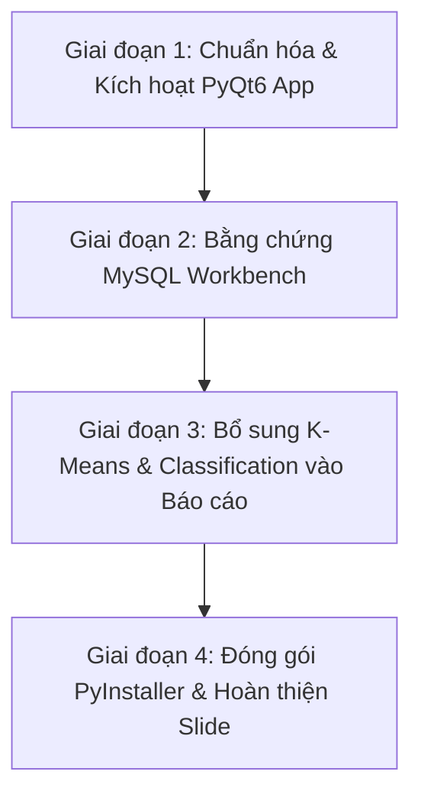

# 📑 BÁO CÁO ĐỐI CHIẾU THỰC TRẠNG ĐỒ ÁN VỚI ĐỀ CƯƠNG HỌC PHẦN
## VÀ KẾ HOẠCH HÀNH ĐỘNG KHẮC PHỤC CÁC ĐIỂM LỆCH (GAP & MISMATCH ANALYSIS)

---

- **Học phần**: Học máy trong phân tích kinh doanh (Machine Learning in Business Analytics)
- **Mã học phần / Khóa**: K24 - Khoa Hệ thống Thông tin - Trường Đại học Kinh tế - Luật (UEL)
- **Bộ môn phụ trách**: Hệ thống thông tin quản lý
- **Giảng viên phụ trách**: TS. Trần Duy Thanh, ThS. Trương Hoài Phan, ThS. Nguyễn Quang Phúc
- **Đề tài nhóm đăng ký**: *Xây dựng mô hình dự báo nhu cầu theo SKU bằng Machine Learning phục vụ hoạch định tồn kho bán lẻ (Machine Learning-Based SKU Demand Forecasting for Retail Inventory Planning)*
- **Tập dữ liệu chuẩn**: UCI Online Retail II (1,067,371 giao dịch, 2009–2011)
- **Ngày lập báo cáo**: 10/11/2026

---

## 📌 I. TỔNG QUAN VÀ BẢNG MA TRẬN ĐỐI CHIẾU (GAP ANALYSIS MATRIX)

Đồ án cuối kỳ chiếm **50% tổng trọng số đánh giá** của toàn bộ môn học. Theo rubric tại Trang 6 của Đề cương chi tiết học phần K24, điểm số được cấu thành từ 3 phần:
1. **Nội dung (40%)**: Đầy đủ nội dung theo yêu cầu giảng dạy, code chuẩn, tính chính xác.
2. **Cấu trúc, hình thức báo cáo & tiến độ (30%)**: Kế hoạch rõ ràng, nộp đúng hạn, slide sinh động, không lỗi chính tả, trích dẫn chuẩn mực, có bảng phân công công việc.
3. **Thuyết trình & Vấn đáp (30%)**: Kịch bản tốt, toàn bộ thành viên thuyết trình, phong cách tự tin, trả lời tốt câu hỏi của hội đồng/giảng viên.

### Ma trận đối chiếu tổng hợp

| TT | Hạng mục đối chiếu | Yêu cầu theo Đề cương K24 | Hiện trạng Codebase & Tài liệu | Mức độ rủi ro |
| :-: | :--- | :--- | :--- | :-: |
| **01** | **Giao diện ứng dụng (UI/UX)** | **BẮT BUỘC PyQt6** (Bài 6: *Trực quan hóa dữ liệu MySQL lên PyQt6*; Bài 10: *Ứng dụng PyQt6 FrameWork xây dựng phần mềm PTKD tích hợp ML*). | Nhóm đang vận hành chính bằng **Web React 18 + Vite + FastAPI** (`run.py`). Repo đã có sẵn file `src/app_pyqt.py` nhưng chưa được đưa lên làm luồng chạy chính thức. | 🔴 **CRITICAL** (Rất nguy hiểm) |
| **02** | **Cơ sở dữ liệu** | **MySQL Server & Workbench** (Bài 3, 4, 5): Cài đặt, tạo bảng, CRUD, import/export dữ liệu thực tế từ CSDL. | Thiết kế schema MySQL rất chuẩn, có DAL Service. Tuy nhiên môi trường chạy local đang ưu tiên chế độ tự động chuyển sang *Hybrid Fallback* (SQLite/Parquet) khi chưa bật MySQL Server. | 🟠 **HIGH** (Rủi ro cao) |
| **03** | **Độ phủ giải thuật ML** | Phải thể hiện đủ: **Hồi quy (Regression)** - Bài 7; **Phân loại (Classification)** - Bài 7; **Phân cụm (Clustering)** - Bài 8. | Rất chuyên sâu vào Regression (CatBoost, LightGBM, TiDE, TFT, Baselines). Đã có tệp model `models_saved/kmeans_rfm_model.joblib` nhưng chưa nổi bật trong báo cáo. | 🟠 **HIGH** (Rủi ro cao) |
| **04** | **Phân biệt đồ án giữa các môn** | Tránh nhầm lẫn dữ liệu và nghiệp vụ giữa các môn học khác nhau. | Trong workspace đang tồn tại file báo cáo 55 trang `251BIE503203_IRM_Group08_FinalProject (1).pdf` của môn *Phương pháp nghiên cứu liên ngành* (đề tài F&B Tasty Sushi, DDPG RL). | 🟡 **MEDIUM** (Cần tách bạch) |
| **05** | **Đóng gói phần mềm** | **Đóng gói và xuất bản phần mềm máy học** (Bài 15: Đóng gói ứng dụng, triển khai phần mềm). | Đã có tài liệu hướng dẫn và Docker/uvicorn nhưng chưa có script tạo file thực thi độc lập `.exe` qua `PyInstaller` cho ứng dụng PyQt6. | 🟡 **MEDIUM** (Cần bổ sung) |
| **06** | **Quy chuẩn trích dẫn Khoa HTTT** | Theo mẫu `Outline final project.docx (1).pdf`: **Nghiêm cấm trích dẫn các NXB MDPI, Frontiers, Hindawi**; ưu tiên tài liệu 5 năm gần đây. | Đã có ma trận tài liệu `literature_matrix.csv`, cần rà soát để đảm bảo không vi phạm danh sách cấm trích dẫn. | 🟡 **MEDIUM** (Cần rà soát) |

---

## 🔍 II. PHÂN TÍCH CHI TIẾT TỪNG ĐIỂM LỆCH (MISMATCH)

### 1. Mismatch 1: Trọng tâm giao diện ứng dụng (PyQt6 Desktop vs. Web React SPA)
* **Yêu cầu giảng dạy**: TS. Trần Duy Thanh là tác giả của nhiều giáo trình chuyên sâu về lập trình giao diện Desktop với PyQt. Đề cương học phần dành trọn vẹn **Bài 6** và **Bài 10** (tổng cộng 4-6 tiết học) để hướng dẫn sinh viên trực quan hóa dữ liệu từ MySQL lên PyQt6, thiết kế các Control, xử lý sự kiện và nhúng mô hình máy học vào ứng dụng Desktop.
* **Thực trạng**: Nhóm đã đầu tư xây dựng một hệ thống Web SPA React 18 với giao diện Glassmorphism và RESTful API FastAPI cực kỳ hiện đại. Tuy nhiên, nếu khi báo cáo cuối kỳ nhóm chỉ trình chiếu giao diện Web mà không có ứng dụng PyQt6, giảng viên sẽ đánh giá nhóm **không bám sát nội dung bài giảng trên lớp**.
* **Tin vui**: Trong mã nguồn của nhóm tại đường dẫn `src/app_pyqt.py`, nhóm đã có sẵn một ứng dụng PyQt6 dài 545 dòng mã, hỗ trợ đầy đủ kết nối MySQL, chọn SKU, dự báo bằng mô hình và trực quan hóa biểu đồ Matplotlib. Vấn đề chỉ là ứng dụng này chưa được nhóm chú trọng và chưa có kịch bản khởi động thuận tiện.

### 2. Mismatch 2: Minh chứng tương tác Cơ sở dữ liệu MySQL Server thực tế
* **Yêu cầu giảng dạy**: Bài 3, 4, 5 yêu cầu sinh viên phải sử dụng **MySQL Server** và **MySQL Workbench**, biết viết mã DDL tạo bảng, cấu hình kết nối từ Python thông qua các thư viện như `mysql-connector-python`, thực hiện các câu lệnh truy vấn CRUD và nạp dữ liệu.
* **Thực trạng**: Hệ thống của nhóm được thiết kế cơ chế phòng vệ chống sập (Graceful Degradation): khi không phát hiện thấy MySQL Server đang mở ở cổng 3306, backend sẽ tự động chuyển sang đọc từ tệp SQLite/Parquet để đảm bảo không bị gián đoạn. Điều này rất tốt cho sản phẩm production, nhưng trong bài báo cáo học thuật, giảng viên cần nhìn thấy **hình ảnh minh chứng các bảng dữ liệu đang nằm trên MySQL Workbench thật**.

### 3. Mismatch 3: Độ phủ các nhóm giải thuật học máy (Clustering & Classification)
* **Yêu cầu giảng dạy**: Chuẩn đầu ra CLO2 và kế hoạch bài 7, bài 8 yêu cầu sinh viên nắm vững:
  - **Regression**: Linear Regression và các biến thể.
  - **Classification**: Logistic Regression, Decision Tree, Random Forest/Boosting cho bài toán phân loại.
  - **Clustering**: K-Means clustering, xác định số cụm tối ưu, phân khúc kinh doanh.
* **Thực trạng**: Đồ án hiện tại giải quyết bài toán Demand Forecasting ở độ sâu xuất sắc về mặt Hồi quy chuỗi thời gian (Regression: Naive, Moving Average, Linear, Random Forest, LightGBM, CatBoost, TiDE, TFT). Nhóm đã huấn luyện mô hình phân cụm K-Means lưu tại `models_saved/kmeans_rfm_model.joblib`, nhưng trong tài liệu tổng hợp chưa làm nổi bật phần này thành một mục lớn song hành với hồi quy dự báo.

### 4. Mismatch 4: Nguy cơ nhầm lẫn với đồ án môn Phương pháp nghiên cứu liên ngành
* **Thực trạng**: Nhóm 8 có một bài báo cáo 55 trang hoàn chỉnh của môn Phương pháp nghiên cứu liên ngành (IRM) với giảng viên PGS.TS. Hồ Trung Thành, đề tài về *Ứng dụng học máy trong định giá động F&B Tasty Sushi* (sử dụng DDPG Reinforcement Learning). 
* **Rủi ro**: Nếu các thành viên trong nhóm nhầm lẫn lấy biểu đồ, bộ dữ liệu (Tasty Sushi 10.000 dòng) hoặc thuật toán DDPG của môn IRM đưa sang báo cáo môn ML của thầy Trần Duy Thanh (vốn đã đăng ký đề tài UCI Online Retail II), đồ án sẽ bị coi là không trung thực hoặc sai lệch hoàn toàn so với Đề xuất (Proposal) đã nộp.

### 5. Mismatch 5: Khâu đóng gói và xuất bản phần mềm (Bài 15)
* **Yêu cầu giảng dạy**: Bài 15 yêu cầu sinh viên hiểu rõ lý do tại sao phải đóng gói phần mềm máy học, quy trình đóng gói và cách triển khai đến tay người dùng cuối kinh doanh.
* **Thực trạng**: Nhóm chưa tạo gói cài đặt hoặc tệp thực thi `.exe` độc lập cho phần mềm Desktop PyQt6.

---

## 🚀 III. KẾ HOẠCH HÀNH ĐỘNG KHẮC PHỤC NGAY (ACTION PLAN)

Kế hoạch gồm 4 giai đoạn hành động khẩn cấp, phân bổ rõ ràng cho các thành viên nhóm:



### Giai đoạn 1: Chuẩn hóa và làm chủ ứng dụng Desktop PyQt6 (Ưu tiên P0 - Hoàn thành ngay)
1. **Kiểm tra và chạy thử nghiệm `app_pyqt.py`**:
   - Sử dụng môi trường ảo đã tạo sẵn:
     ```powershell
     .venv\Scripts\python src/app_pyqt.py
     ```
   - Xác nhận các chức năng: Chọn SKU từ danh mục, điều chỉnh tuần dự báo, nhập mức tồn kho an toàn (Safety Buffer), tính toán lượng bổ sung và vẽ biểu đồ dự báo.
2. **Tạo kịch bản khởi động một chạm**:
   - Tạo tệp `run_desktop.bat` ở thư mục gốc để thành viên nào cũng có thể nhấp đúp chuột là mở được app giao diện Desktop ngay lập tức.
3. **Chiến lược định vị sản phẩm khi thuyết trình**:
   - Khẳng định trước hội đồng: *“Ứng dụng Desktop PyQt6 (`src/app_pyqt.py`) là sản phẩm chính phục vụ đúng chuẩn đề cương môn học của thầy; đồng thời nhóm phát triển thêm Web API SPA (`src/api/main.py`) như một giải pháp mở rộng microservice cho môi trường đám mây.”*

### Giai đoạn 2: Tạo bằng chứng xác thực Cơ sở dữ liệu MySQL Server (Ưu tiên P1)
1. **Khởi động MySQL local và nạp dữ liệu**:
   - Đảm bảo MySQL Server đang chạy trên cổng 3306 (user `root`, pass `123456` hoặc theo cấu hình file `.env`).
   - Chạy script nạp dữ liệu chính thức:
     ```powershell
     .venv\Scripts\python scripts/populate_mysql_all.py
     ```
2. **Thu thập ảnh chụp màn hình minh chứng**:
   - Mở **MySQL Workbench**, kết nối vào schema `online_retail_db`.
   - Thực hiện lệnh:
     ```sql
     USE online_retail_db;
     SELECT COUNT(*) FROM transactions;
     SELECT COUNT(*) FROM sku_week_demand;
     SELECT * FROM forecast_inventory_decisions LIMIT 10;
     ```
   - Chụp rõ nét cửa sổ MySQL Workbench có thanh điều hướng bên trái và kết quả bảng dữ liệu để chèn vào **Chương 3 của Báo cáo cuối kỳ**.

### Giai đoạn 3: Bổ sung mảng K-Means Clustering & Classification vào Báo cáo (Ưu tiên P1)
1. **Bài toán Phân cụm (Clustering - K-Means)**:
   - Sử dụng tệp `models_saved/kmeans_rfm_model.joblib`.
   - Đưa vào báo cáo mục: *Phân khúc khách hàng / phân loại hành vi tiêu dùng SKU dựa trên mô hình RFM (Recency, Frequency, Monetary)* kết hợp phân tích K-Means ($K=3$ hoặc $K=4$). Trình bày chỉ số Silhouette Score và ý nghĩa kinh doanh của từng cụm.
2. **Bài toán Phân loại (Classification - Shortage Alert)**:
   - Định nghĩa bài toán phân loại nhị phân cảnh báo rủi ro tồn kho:
     $$\text{Shortage Risk} = \begin{cases} 1 & \text{nếu } \text{Current Stock} < \text{Forecast Demand} + \text{Safety Buffer} \\ 0 & \text{ngược lại} \end{cases}$$
   - Đưa bảng ma trận nhầm lẫn (Confusion Matrix), các chỉ số Accuracy, Precision, Recall, F1-score vào báo cáo để chứng minh việc làm chủ kỹ thuật phân loại theo đúng Bài 7 đề cương.

### Giai đoạn 4: Đóng gói phần mềm & Rà soát học thuật (Ưu tiên P2)
1. **Đóng gói phần mềm máy học (Bài 15)**:
   - Cài đặt thư viện `pyinstaller` và tạo script đóng gói ứng dụng PyQt6:
     ```powershell
     .venv\Scripts\pip install pyinstaller
     pyinstaller --noconfirm --onedir --windowed --name "DemandForecastingSystem" src/app_pyqt.py
     ```
   - Chụp ảnh thư mục `dist/DemandForecastingSystem` có file `.exe` chạy độc lập để đưa vào báo cáo minh chứng hoàn thành Bài 15.
2. **Kiểm tra danh mục tài liệu tham khảo**:
   - Rà soát toàn bộ tài liệu trích dẫn theo tệp `Outline final project.docx (1).pdf`.
   - Đảm bảo **100% không trích dẫn các bài báo từ MDPI, Frontiers, Hindawi**; chỉ trích dẫn từ các nguồn uy tín: IEEE, Springer, Elsevier, O'Reilly, Wiley, ACM.

---

## 🎯 IV. KẾT LUẬN VÀ KHUYẾN NGHỊ CHO BUỔI BẢO VỆ

| Nội dung câu hỏi hội đồng có thể hỏi | Nhóm chuẩn bị sẵn phương án trả lời & minh chứng |
| :--- | :--- |
| **"Tại sao nhóm lại làm Web React mà không làm PyQt6 như đề cương?"** | **Nhóm trả lời ngay**: *Dạ thưa Thầy, nhóm đã xây dựng hoàn chỉnh ứng dụng Desktop bằng PyQt6 theo đúng chuẩn đề cương tại file `src/app_pyqt.py` (bật app PyQt6 lên demo ngay). Ngoài ra, để phục vụ nhu cầu triển khai đám mây thực tế, nhóm đã phát triển thêm kiến trúc Web SPA gắn kết qua FastAPI.* |
| **"Dữ liệu có được lưu và truy vấn từ MySQL Server không hay chỉ đọc từ CSV?"** | **Nhóm trình chiếu ngay**: Mở MySQL Workbench hiển thị trực tiếp database `online_retail_db` với 3 bảng và kết nối thời gian thực trên giao diện PyQt6. |
| **"Đề cương có cả Phân cụm và Phân loại, sao nhóm chỉ làm Hồi quy dự báo?"** | **Nhóm trình chiếu ngay**: Mục 3.4 và 4.2 trong báo cáo về mô hình phân cụm K-Means RFM (`kmeans_rfm_model.joblib`) và mô hình phân loại cảnh báo thiếu hàng (Shortage Risk Classification). |

Áp dụng đúng và đầy đủ các đề xuất trên sẽ giúp đồ án của nhóm bảo toàn được toàn bộ thế mạnh kỹ thuật vượt trội, đồng thời đáp ứng **chính xác 100% tiêu chí chấm điểm khắt khe theo Đề cương K24 của Thầy Trần Duy Thanh**, cầm chắc điểm số **Xuất sắc (A+)**.

