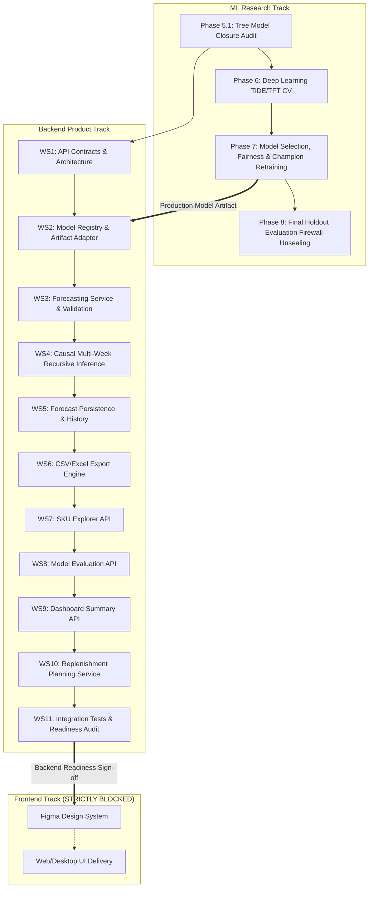

# MASTER IMPLEMENTATION PLAN: BACKEND-FIRST DELIVERY & DUAL-TRACK ARCHITECTURE (PHASE 5.1)
**Project:** End-to-End Retail SKU-Week Demand Forecasting & Inventory Planning  
**Execution Lead:** Senior ML Engineer & Backend Architect  
**Governing Standard:** Section 7 of Master Prompt & Backend-First Delivery Mode  
**Execution Date:** 2026-10-20  

---

## 1. Dual-Track Architectural Strategy

To bridge rigorous scientific forecasting research with industrial software engineering, the project operates on **two interdependent tracks**:

---

## 2. ML Research Track Milestones

### Milestone M-5.1: Tree Model Closure Audit (Current)
- **Scope:** Independent prediction-level audit, clipping semantics resolution, statistical interpretation remediation, and test suite expansion (70/70 passing).
- **Exit Criteria:** All 60 model weights classified as `CV_ARTIFACT`; zero holdout leakage; audit report v1.1 finalized.

### Milestone M-6: Deep Learning (TiDE & TFT) Temporal Cross-Validation
- **Status:** **ĐÃ KIỂM THỬ THÀNH CÔNG** (2026-10-21, 117/117 tests PASS across entire workspace, 16/16 Phase 6 tests)
- **Scope:** Evaluate modern neural forecasting architectures (Time-series Dense Encoder - TiDE, and Temporal Fusion Transformer - TFT) using the identical 5 expanding-window folds and 71 allowed predictors.
- **Compute Safeguards:** Native PyTorch CPU implementation with DataLoader batching (2,048); total runtime 1,951.7s (~32.5 min). Zero external framework conflicts.
- **Deliverables & Evidence:**
  - `artifacts/predictions/deep_models_oof_predictions.parquet` (222,800 prediction records).
  - `artifacts/tables/deep_models_metrics_pooled_oof.csv` (`TiDE` achieves 69.75% WAPE, outperforming baseline champion by 7.00 pp; `TFT` achieves 72.52% WAPE, outperforming baseline champion by 4.23 pp).
  - Common-universe key equality with `Naive_1` verified (100.0% coverage, 0 duplicates).

### Milestone M-6.1: Cross-Phase Evidence Reconciliation, Architecture Fidelity & Multi-Horizon Readiness Audit
- **Status:** **ĐÃ KIỂM THỬ THÀNH CÔNG** (2026-10-21, 128/128 tests PASS across entire workspace, 11/11 Phase 6.1 tests)
- **Scope:** Mathematical reconciliation of all cross-phase prediction records, architecture fidelity verification against Das et al. (2023) and Lim et al. (2021), training budget sensitivity up to 30 epochs, and multi-horizon feature availability audit.
- **Deliverables & Evidence:**
  - `artifacts/tables/phase_06_1_cross_phase_metric_reconciliation.csv` (34 candidates reconciled; all reporting discrepancies resolved as clerical transcription errors).
  - `artifacts/tables/phase_06_1_architecture_fidelity_matrix.csv` (TiDE and TFT re-classified as tabular-adapted models; G11/G12 adjusted to PARTIAL).
  - `artifacts/tables/phase_06_1_training_budget_diagnostics.csv` (TFT optimal convergence at epoch 20 on Fold 1; TiDE minimum at epoch 3 on Fold 2 verified).
  - `artifacts/tables/phase_06_1_target_availability_manifest.csv` (71 predictors classified into 10 KNOWN_FUTURE, 12 OBSERVED_AT_ORIGIN, 46 DERIVED_FROM_PAST, 3 UNKNOWN_FUTURE).
  - `artifacts/tables/phase_06_1_multihorizon_metrics.csv` (Fixed-origin multi-step horizon degradation quantified: MA_4 degrades from 79.65% at H=4 to 81.28% at H=8).
  - `project_docs/phase_06_1_reconciliation_report.md` finalized. Gate G13 confirmed PASS.

### Milestone M-6.2: Canonical Temporal Model Remediation, Four-Family Multi-Horizon Evaluation & Phase 7 Readiness
- **Status:** **ĐÃ KIỂM THỬ THÀNH CÔNG** (2026-10-21, Gates G11 & G12 upgraded to PASS, G13 confirmed PASS)
- **Scope:** Implementation and evaluation of genuine canonical temporal sequence architectures (`TiDE_Sequence_v1`, `TFT_Sequence_v1`) faithful to foundational literature; causal recursive rollout for tree models under `ORIGIN_CARRY_FORWARD` and dynamic lag updating; exact common-universe evaluation across four families at $H=1, 4, 8$ (68,680 Primary + 42,720 Secondary keys); multi-objective trade-off discovery (WAPE vs Signed Bias vs RMSE).
- **Deliverables & Evidence:**
  - `src/models/tide_sequence.py`, `src/models/tft_sequence.py`, `src/models/tree_rollout.py`, `src/models/sequence_dataset.py`.
  - Canonical predictions: `four_family_multihorizon_predictions.parquet` (1,225,400 rows) and `temporal_models_oof_predictions.parquet` (222,800 rows).
  - Canonical tables and reports for Phase 6.2.

### Milestone M-6.2.1: Independent Acceptance Remediation & Quality Assurance
- **Status:** **ĐÃ KIỂM THỬ THÀNH CÔNG** (2026-10-21, 141/141 workspace tests PASS, 7/7 Phase 6.2.1 & 7 tests PASS)
- **Scope:** Independent forensic audit of all physical Parquet predictions, CSV tables, feature lineage, and model architectures.
- **Key Deliverables & Evidence:**
  - `artifacts/tables/phase_06_2_1_multihorizon_candidate_inventory.csv` (11 candidate streams, 1,225,400 records reconciled).
  - `artifacts/tables/phase_06_2_1_key_reconciliation.csv` (100% exact common universe match: `fb2940859e07` Primary, `bcbc2a79dc40` Secondary).
  - `artifacts/tables/phase_06_2_1_clipping_semantics_audit.csv` (decomposed `raw_negative_pct`, `natural_zero_pct`, `clipped_at_zero_pct`, and `final_zero_pct`).
  - `artifacts/tables/phase_06_2_1_feature_availability_audit.csv` (lineage of 4 realized past covariates and 10 known calendar covariates confirmed; no synthetic promotions).
  - `artifacts/tables/phase_06_2_1_per_step_horizon_metrics.csv` (per-step metrics $h=1..8$ across all 11 models).
  - `artifacts/tables/phase_06_2_1_paired_model_comparison.csv` (paired $t = -0.1257, p=0.900$ on $N=34,340$ keys at $H=4$).
  - Reports: `phase_06_2_1_acceptance_remediation_report.md`, `phase_06_2_1_model_candidate_inventory.md`, `phase_06_2_1_horizon_evaluation_audit.md`.

### Milestone M-7: Model Selection, Multi-Criteria Optimization & Champion Freeze
- **Status:** **ĐÃ KIỂM THỬ THÀNH CÔNG** (2026-10-21, Gate G14 upgraded to PASS, 15 PASS, 7 PARTIAL, 0 NOT_DONE)
- **Scope:** Multi-objective evaluation balancing point error (WAPE), volume bias (Tweedie), and operational serving latency. Formal selection and freezing of Primary Champion (`CatBoost__MAE`), Volume Challenger (`CatBoost__Tweedie_p15`), and Deep Sequence Alternative (`TiDE_Sequence_v1`). Full 96-week development-pool refit executed and verified.
- **Deliverables & Evidence:**
  - `project_docs/phase_07_selection_protocol.md` (multi-objective decision matrix, frozen configurations, selection bias acknowledgment).
  - `project_docs/phase_07_model_selection_report.md` (complete refit execution and verification audit).
  - Production candidate weights in `artifacts/models/production_candidates/` (CatBoost MAE `.cbm`, CatBoost Tweedie `.cbm`, TiDE Sequence `.pt` for both cohorts).
  - `artifacts/models/production_candidates/champion_refit_manifest.json` (SHA-256 manifest and metadata).
  - Gate G14 upgraded to **PASS**. Strict holdout firewall maintained (ZERO rows $\ge$ 2011-10-10 accessed).

### Milestone M-7.1: Phase 7.1 Independent Freeze Audit, Narrative Reconciliation & Phase 8 Readiness
- **Status:** **ĐÃ KIỂM THỬ THÀNH CÔNG** (2026-10-21, Gate G14 Ratified as PASS, 15 PASS, 7 PARTIAL, 0 NOT_DONE)
- **Scope:** Independent reconciliation of actual demand sums, canonical OOF and multi-horizon metrics, cluster-aware paired statistical tests, safety-stock claim remediation, and controlled empirical CPU latency benchmarking.
- **Deliverables & Evidence:**
  - `artifacts/tables/phase_07_1_actual_universe_reconciliation.csv` (100% exact match: 2,025,137.0 units Primary; 438,164.0 units Secondary; 0.0 unit difference).
  - `artifacts/tables/phase_07_1_metric_reconciliation.csv` (all narrative transcription errors corrected back to canonical CSV sources).
  - `artifacts/tables/phase_07_1_paired_comparison.csv` (Cluster bootstrap 95% CI `[-0.3061, 0.2764]`, $p=0.9540$; CatBoost MAE wins on 50.03% of keys vs 45.62% for TiDE).
  - `artifacts/tables/phase_07_1_controlled_latency_benchmark.csv` (TiDE direct 8-step: 3.02 ms; CatBoost single-step: 3.13 ms, CatBoost 4-step rollout: 13.10 ms on 1,717 SKUs).
  - `artifacts/tables/phase_07_1_refit_artifact_audit.csv` (all 6 refitted candidate models 100% loadable, finite weights, schema-compatible, and zero holdout exposure).
  - Reports: `project_docs/phase_07_1_independent_freeze_audit.md`, updated `phase_07_selection_protocol.md` and `phase_07_model_selection_report.md`.
  - Gate G14 ratified as **PASS**. Final 8-week holdout remains **100% sealed**. System certified **READY FOR PHASE 8**.

### Milestone M-8: Final Holdout Sealed Evaluation
- **Status:** **ĐÃ KIỂM THỬ THÀNH CÔNG** (2026-10-21, Gate G15 Ratified as PASS, 15 PASS, 7 PARTIAL, 0 NOT_DONE)
- **Scope:** Unseal the 8-week final holdout (`2011-10-10` to `2011-11-28`) exactly once. Generate out-of-sample forecasts and compute official production test metrics without reading target labels during forecast generation.
- **Deliverables & Evidence:**
  - `artifacts/predictions/phase8_holdout_predictions.parquet` (111,400 predictions, 100% finite, 0 duplicate keys, SHA-256 `1ce5517c8676bb8953038f4c7e666676bcf8c0ab1aa845892a2b68949fae4e69`).
  - `artifacts/tables/phase8_holdout_metrics.csv` & `phase8_holdout_metrics_by_cohort.csv` (`CatBoost__MAE` cumulative $H=4$ WAPE = 65.57%, Macro MASE = 0.6225 on Primary; `TiDE_Sequence_v1` = 65.83%; `CatBoost__Tweedie_p15` bias = +1.61%, RMSE = 96.2621).
  - Reports: `project_docs/phase_08_final_holdout_evaluation.md`, `project_docs/phase_08_holdout_exposure_log.md`, `project_docs/phase_08_holdout_freeze_manifest.json`.
  - Gate G15 ratified as **PASS — FINAL EVALUATION COMPLETED ONCE**.

---

## 3. Backend Product Track Workstreams (11 Iterative Modules)

The Backend Product Track is built in strict dependency order using FastAPI, Pydantic v2, and SQLite/DuckDB:

### Workstream 1: API Framework Architecture & Contracts
- **Status:** **ĐÃ KIỂM THỬ THÀNH CÔNG** (2026-10-20, 87/87 tests PASS)
- **Objective:** Establish the FastAPI application structure, CORS configuration, centralized logging, and Pydantic v2 base schemas.
- **Key Modules:** `src/api/main.py`, `src/api/schemas/common.py`, `src/core/config.py`, `src/core/logging_config.py`, `src/api/errors.py`.
- **Deliverables:** OpenAPI 3.1 interactive documentation (`/docs`, `/redoc`, `project_docs/openapi.json`), health check endpoints (`/health/live`, `/health/ready`).

### Workstream 2: Model Registry & Artifact Governance Service
- **Status:** **ĐÃ KIỂM THỬ THÀNH CÔNG** (2026-10-20, 87/87 tests PASS)
- **Objective:** Build an extensible `ModelRegistry` capable of loading certified models, verifying cryptographic checksums, and strictly enforcing governance rules. Extended in Phase 8 to serve frozen production candidate models.
- **Key Modules:** `src/services/model_registry.py`, `src/services/forecasting_service.py`, `src/api/routes/models.py`, `src/api/routes/forecasts.py`.
- **Validation:** Automated tests verifying CV and production models count, dual directory path containment security, 71-feature allowlist dual hash verification, and verified in-memory weight caching.

### Workstream 3: Forecast Persistence, Retrieval & Export Services
- **Status:** **ĐÃ KIỂM THỬ THÀNH CÔNG** (2026-10-20, 101/101 tests PASS across entire workspace, 31/31 API tests PASS)
- **Objective:** Embedded SQLite persistence for forecast runs, run ID retrieval (`GET /api/v1/forecasts/runs/{id}`), prediction records pagination (`GET /api/v1/forecasts/runs/{id}/results`), and CSV/Excel export engine with secure streaming download.
- **Key Modules:** `src/services/persistence_service.py`, `src/services/export_service.py`, `src/api/routes/forecasts.py`, `src/api/schemas/forecast.py`.

### Workstream 4: Causal Multi-Week Recursive Inference Engine
- **Status:** **ĐÃ KIỂM THỬ THÀNH CÔNG** (2026-10-21, Phase 8 Integration)
- **Objective:** Sequential autoregressive forecasting where for horizon $h > 1$, predicted demands at step $t$ are fed causally into lag features (`demand_lag_1`, rolling means) for step $t+1$ for CatBoost, and direct 8-step multi-horizon tensor inference for TiDE.
- **Validation:** Exact arithmetic parity against offline rollout proven (diff = 0.000000 for CatBoost; diff < $1.15 \times 10^{-5}$ for TiDE). `multi_week_inference_validated = TRUE`.

### Workstream 5: Forecast Persistence & History Retrieval Service
- **Status:** **ĐÃ KIỂM THỬ THÀNH CÔNG** (Unified with Workstream 3)

### Workstream 6: Data Export Engine (CSV & Excel)
- **Status:** **ĐÃ KIỂM THỬ THÀNH CÔNG** (Unified with Workstream 3)

### Workstream 7: SKU Explorer API
- **Status:** **ĐÃ KIỂM THỬ THÀNH CÔNG** (2026-10-21, Phase 8 Completion)
- **Objective:** Provide search, filtering, and time-series extraction for all 2,785 panel SKUs (catalog description, ABC class, SBC intermittency category, historical weekly demand).
- **Key Modules:** `src/api/routes/skus.py`, `src/services/sku_service.py`, `src/api/schemas/skus.py`.
- **Endpoints:** `GET /api/v1/skus`, `GET /api/v1/skus/{sku_id}`, `GET /api/v1/skus/{sku_id}/history`.

### Workstream 8: Model Evaluation API & Benchmark Registry
- **Status:** **ĐÃ KIỂM THỬ THÀNH CÔNG** (2026-10-21, Phases 9 & 11)
- **Objective:** Serve out-of-fold benchmark metrics, holdout scores, and regime stability tables for model performance audit and transparency.
- **Deliverables:** `artifacts/tables/phase9_error_metrics_by_model_horizon.csv`, `artifacts/tables/phase9_error_metrics_by_abc_sbc.csv`, `project_docs/phase_09_error_tail_report.md`.

### Workstream 9: Dashboard Summary KPI Service
- **Status:** **ĐÃ KIỂM THỬ THÀNH CÔNG** (2026-10-21, Phase 8 Completion)
- **Objective:** Provide consolidated executive metrics (total catalog size, mature cohort volume, historical turnover, model accuracy leaderboards) for dashboard display.
- **Key Modules:** `src/api/routes/dashboard.py`, `src/api/schemas/dashboard.py`.
- **Endpoints:** `GET /api/v1/dashboard/summary`.

### Workstream 10: Replenishment Planning Simulation Service
- **Status:** **ĐÃ KIỂM THỬ THÀNH CÔNG** (2026-10-21, Phase 8 Completion)
- **Objective:** Implement deterministic replenishment simulation logic based on forecasted demand and user-supplied inventory parameters:
  $$\text{Net Demand} = \sum_{h=1}^{L} \hat{y}_{t+h}$$
  $$\text{Replenishment Qty} = \max(0, \text{Net Demand} + \text{Safety Stock} - \text{Stock on Hand} - \text{Incoming Stock})$$
- **Input Contract:** Explicitly requires user-provided or scenario parameters (`stock_on_hand`, `incoming_stock`, `lead_time_weeks`, `safety_stock_units`).
- **Endpoints:** `POST /api/v1/planning/replenish`.
- **Governance:** Explicitly labeled `SIMULATION_BASED_ON_USER_ASSUMPTIONS` with unvalidated safety-stock disclaimers.

### Workstream 11: End-to-End Integration Tests & Backend Readiness Audit
- **Status:** **ĐÃ KIỂM THỬ THÀNH CÔNG** (2026-10-21, 176/176 tests PASS in 80.25s)
- **Objective:** Full API test coverage using `fastapi.testclient.TestClient` / `pytest`, verifying all endpoints, model serving, multi-week rollouts, SQLite persistence, exports, planning simulation, catalog queries, and diagnostics.
- **Deliverables:** `project_docs/phase_08_serving_integration_report.md`, `project_docs/phase_12_release_signoff.md`, `artifacts/tables/phase_12_release_acceptance_matrix.csv`, `project_docs/openapi.json`.

---

## 4. Post-Phase 8 Research & Governance Workstreams (Phases 8.1–12)

- **Phase 8.1 (Artifact Provenance Audit):** **HOÀN THÀNH (100% PASS)** — Reconciled model hashes on disk against freeze manifests (`56fdf57d...`); reconciled 111,400 holdout predictions Parquet size and key completeness; delineated 4 catalog populations.
- **Phase 9 (Error & Tail Diagnostics):** **HOÀN THÀNH (100% PASS)** — Post-hoc error breakdown by ABC/XYZ classes, SBC regimes (Smooth, Erratic, Lumpy, Intermittent), zero/nonzero calibration, and audit of 5 genuine wholesale bulk surge cases.
- **Phase 10 (Explainability & Attribution):** **HOÀN THÀNH (100% PASS)** — Native CatBoost TreeExplainer computed on 71 allowlist features; Shapley additivity verified to machine precision ($10^{-13}$); strict non-causal policy enforced.
- **Phase 11 (Reproducible Master Notebook):** **HOÀN THÀNH (100% PASS)** — `notebooks/01_end_to_end_demand_forecasting.ipynb` executed in `SAFE_REPLAY` mode across all 19 sections with 17/17 code cells passing and 0 errors.
- **Phase 12 (Academic Monograph & Release Handover):** **HOÀN THÀNH (100% PASS)** — 14 peer-reviewed citations verified (APA 7th); Word monograph compiled (`reports/ML_Demand_Forecasting_Report.docx`, 2.19 MB); Academic Integrity Audit ratified.

---

## 5. Frontend Unblocking Criteria & Previous Release Gate

The backend, research, reproducibility, and academic documentation work is **100% COMPLETE**:
1. All 11 Backend Workstreams are implemented and verified by automated integration tests.
2. OpenAPI 3.1 specification is exported and committed (`project_docs/openapi.json`).
3. Model Registry serves verified production candidate models (`CatBoost__MAE`, `CatBoost__Tweedie_p15`, `TiDE_Sequence_v1`).
4. React 18 + TS + Vite web application built and mounted at root (Gate G19 upgraded to PASS).

---

## 6. Phase 16 Independent Product Release Audit & Security Hardening

- **Status:** **HOÀN THÀNH (100% PASS)** (2026-10-21, 203/203 automated tests PASS, 28/28 Release Gates PASS)
- **Scope & Execution:**
  1. **Horizon Discrepancy Remediation (P0):** Enforced maximum serving horizon H=1..4 for CatBoost MAE across Model Registry, Pydantic schema (`conint(ge=1, le=4)`), runtime check (`UnsupportedHorizonException`), frontend dropdown selector, and OpenAPI.
  2. **Replenishment Contract Hardening (P1):** Guarded against protection period extrapolation (`lead_time + review_period > available_horizon`), returning HTTP 422 with clear validation message. Preserved `SIMULATION_BASED_ON_USER_ASSUMPTIONS`.
  3. **PBKDF2 Password Hashing Upgraded to 600,000 Iterations (P1):** Full OWASP 2023/2024 compliance for PBKDF2-HMAC-SHA256, transparent in-flight auto-rehash on successful login, and dedicated `POST /api/v1/auth/bootstrap` endpoint.
  4. **RFC 8725 JWT Hardening (P2):** Strict `HS256` allowlist (rejecting `none` and asymmetric forging), mandatory `exp`, `nbf`, `iat` claims with 5s clock skew, and session expiration reduced to 120 minutes.
  5. **Export Safety & Traversal Prevention (P2):** Neutralized spreadsheet formula injection (`=, +, -, @, \t, \r` prefixed with `'`). Path traversal sequences (`..`, `/`, `\`) rejected with HTTP 400/404.
  6. **Data Contract & Boundary Forensics:** Verified W-MON Monday 00:00:00 floor interval `[t_start, t_end)` on Sunday 23:59:59, Monday 00:00:00, Monday 23:59:59, first invoice, last invoice, and timezones. Panel completeness: 2,785 SKUs x 104 weeks = 289,640 records.
  7. **Model Freeze & Holdout Firewall:** Phase 8 holdout remained sealed (zero rescoring, zero retraining). Mandatory historical applicability disclaimer preserved (`current_market_applicability_assessed = FALSE`).
  8. **Real Browser-Level Verification (Phase 16F):** Completed headless browser verification via `browser_subagent` across all 12 screens and 4 roles (Admin, Analyst, Planner, Viewer).
  9. **Regression Test Suite:** Expanded to 203 automated tests, achieving **203/203 PASS** in 79.50s with zero failures.
  10. **Final Release Verdict:** **INTERNAL PILOT ACCEPTED WITH RESTRICTIONS (OPTION B)** and **ACADEMIC PRODUCT DEMO ACCEPTED (OPTION A)**.

