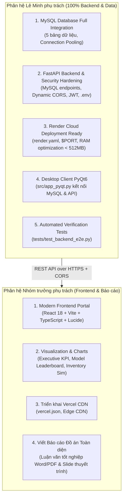

# BẢN ĐẶC TẢ KỸ THUẬT & MASTER PROMPT HOÀN THIỆN BACKEND, DATABASE & CLOUD RENDER
## TECHNICAL HANDOVER & FULL BACKEND SPECIFICATION FOR LE MINH (`minhllk24`)

* **Dự án:** Retail SKU-Week Demand Forecasting & Inventory Planning Platform
* **Môn học:** Học máy (Machine Learning) — GVHD: Thầy Trần Duy Thanh (Lớp sáng thứ 4)
* **Người giao nhiệm vụ:** Nhóm trưởng (Team Lead / PM & Frontend Lead)
* **Người nhận nhiệm vụ:** Lê Minh (`minhllk24`) — Backend & Database Lead
* **Ngày chuyển giao:** 24/10/2026
* **Mục tiêu chiến lược:** Phân định rõ ràng trách nhiệm: Minh phụ trách **100% Backend, Database MySQL/SQLite, Triển khai Render Cloud và Desktop PyQt6**, giúp Nhóm trưởng tập trung **100% vào Frontend Trực quan (Vercel) và Viết Báo cáo Đồ án / Slide Thuyết trình cuối kỳ**.

---

## PHẦN 1: BỐI CẢNH & MA TRẬN PHÂN CHIA TRÁCH NHIỆM

Nhằm tối ưu hóa hiệu suất làm việc để đạt điểm tuyệt đối cho đồ án môn học, nhóm thống nhất phân định ranh giới trách nhiệm (Demarcation of Responsibility) như sau:



### Chi tiết Phân công:

| Phân hệ / Hạng mục | Người phụ trách chính | Mục tiêu bàn giao |
| :---|:---:|:---|
| **CSDL MySQL & Storage** | **Lê Minh** | 100% dữ liệu 5 bảng trong MySQL, Connection Pool, nạp kết quả tồn kho `forecast_inventory_decisions`. |
| **FastAPI Backend & Security** | **Lê Minh** | API router kết nối MySQL, chuẩn hóa bảo mật RFC 8725, xóa hardcode mật khẩu, nạp config từ `.env`. |
| **Đóng gói Cloud Render** | **Lê Minh** | Cấu hình `render.yaml`, chạy port động `$PORT`, kiểm soát RAM < 512MB, mở CORS cho Vercel. |
| **Desktop PyQt6 (Deliverable 7)** | **Lê Minh** | Cập nhật `src/app_pyqt.py` kết nối trực tiếp CSDL MySQL hoặc API Backend. |
| **Frontend UI & Visualization** | **Nhóm trưởng** | Hoàn thiện toàn bộ giao diện Web React 18, biểu đồ tương tác, kết nối API backend. |
| **Triển khai Vercel** | **Nhóm trưởng** | Đưa Frontend lên Vercel Edge Network, trỏ API sang Render của Minh. |
| **Báo cáo Đồ án & Slide** | **Nhóm trưởng** | Viết toàn bộ cuốn báo cáo cuối kỳ 16 Phase theo chuẩn học thuật và slide báo cáo hội đồng. |

---

## PHẦN 2: ĐÁNH GIÁ HIỆN TRẠNG & CÁC ĐIỂM NGHẼN CẦN GIẢI QUYẾT

### ✅ Đánh giá cao kết quả Phase 02 của Minh:
* Minh đã nạp thành công **2,470,797 dòng** vào 4 bảng MySQL `online_retail_db` (`online_retail`, `transactions`, `sku_week_demand`, `forecast_predictions`).
* Xử lý xuất sắc lỗi trùng lặp khóa chính bằng Auto-increment ID và Composite Index.
* Xử lý tốt lỗi phân biệt hoa thường của mã hàng bằng collation `COLLATE utf8mb4_bin`.
* Batch Ingestion đạt tốc độ 14,000 – 17,000 dòng/giây.

### ⚠️ 5 Điểm nghẽn kỹ thuật Minh cần xử lý dứt điểm:
1. **Bảng số 5 `forecast_inventory_decisions` trong MySQL còn trống:** Mới chỉ có DDL, chưa có dữ liệu kết quả từ mô phỏng tồn kho `src/inventory_sim.py`.
2. **Backend API chưa kết nối MySQL:** Toàn bộ các router hiện tại trong `src/api/routes/` đang đọc từ SQLite (`data/backend_storage/forecasts.sqlite3`) và Parquet/JSON. MySQL hiện chỉ là kho tĩnh, chưa được phục vụ ra API.
3. **Mật khẩu MySQL đang hardcode `'123456'`:** Khi chạy trên máy tính khác hoặc trên Cloud, kết nối sẽ bị văng lỗi `Access denied for user 'root'@'localhost'` nếu mật khẩu khác `123456`. Cần đọc qua file `.env` và `os.getenv()`.
4. **Chưa sẵn sàng triển khai Render cho Vercel:**
   * Backend hiện chỉ chấp nhận CORS localhost (`http://localhost:5173`,...). Khi Frontend lên Vercel (`https://*.vercel.app`), trình duyệt sẽ chặn toàn bộ API do vi phạm CORS.
   * Cần có file cấu hình triển khai `render.yaml` và cơ chế fallback an toàn (nếu môi trường không có MySQL thì tự động dùng SQLite/Parquet mà không làm sập server).
5. **Giao diện Desktop PyQt6 (`src/app_pyqt.py`):** Hiện vẫn đọc từ file CSV cục bộ, chưa tích hợp kết nối MySQL Server để đáp ứng Deliverable 7 của Thầy Duy Thanh.

---

## PHẦN 3: KẾ HOẠCH HÀNH ĐỘNG 5 GÓI CÔNG VIỆC DÀNH CHO MINH

---

### GÓI 1: Hoàn thiện CSDL MySQL & Nạp Bảng Tồn Kho (Deliverable 2 Completion)

1. **Nạp dữ liệu vào bảng `forecast_inventory_decisions`:**
   * Viết hàm đọc kết quả dự báo holdout và chạy logic tồn kho `src/inventory_sim.py` để tính:
     * `simulated_current_stock`
     * `safety_buffer` (Safety Stock theo z-score 90%)
     * `projected_requirement`
     * `attention_flag` (`'SHORTAGE RISK'`, `'ADEQUATE'`, `'EXCESS STOCK'`)
     * `suggested_order_qty`
   * Nạp toàn bộ dữ liệu này vào bảng `forecast_inventory_decisions`.
2. **Cấu hình Connection Pooling an toàn trong [src/database.py](file:///c:/Users/thain/Downloads/ML%20Đồ%20Án/src/database.py):**
   * Sử dụng `mysql.connector.pooling.MySQLConnectionPool` với pool size = 5 để tránh quá tải kết nối khi API nhận nhiều request đồng thời.
   * Hỗ trợ đọc thông tin kết nối từ file `.env` qua `python-dotenv`:
     * `MYSQL_HOST` (mặc định: `127.0.0.1`)
     * `MYSQL_PORT` (mặc định: `3306`)
     * `MYSQL_USER` (mặc định: `root`)
     * `MYSQL_PASSWORD` (mặc định: đọc từ env, fallback rỗng hoặc thông báo rõ ràng)
     * `MYSQL_DATABASE` (mặc định: `online_retail_db`)

---

### GÓI 2: Tích hợp API Backend FastAPI với MySQL (Dual-Mode Architecture)

Tạo router mới [src/api/routes/database.py](file:///c:/Users/thain/Downloads/ML%20Đồ%20Án/src/api/routes/database.py) và service [src/services/mysql_service.py](file:///c:/Users/thain/Downloads/ML%20Đồ%20Án/src/services/mysql_service.py) để cung cấp các REST API endpoints truy vấn CSDL quan hệ:

| Method | Endpoint | Mô tả nghiệp vụ | Nguồn dữ liệu |
| :---: | :---| :---| :---|
| `GET` | `/api/v1/database/health` | Kiểm tra trạng thái kết nối MySQL và số lượng bản ghi của 5 bảng | MySQL Server |
| `GET` | `/api/v1/database/transactions` | Tra cứu lịch sử hóa đơn phân trang (`limit`, `offset`, `stock_code`, `invoice`) | Bảng `transactions` |
| `GET` | `/api/v1/database/demand-panel` | Lấy dữ liệu nhu cầu tuần của SKU phục vụ vẽ biểu đồ | Bảng `sku_week_demand` |
| `GET` | `/api/v1/database/predictions` | Lấy danh sách dự báo của các mô hình theo SKU và tuần mục tiêu | Bảng `forecast_predictions` |
| `GET` | `/api/v1/database/inventory-decisions` | Lấy danh sách khuyến nghị đặt hàng và cảnh báo tồn kho | Bảng `forecast_inventory_decisions` |

> [!IMPORTANT]
> **Quy tắc Vàng (Graceful Degradation):** Nếu máy chủ Render hoặc môi trường test không kết nối được MySQL (ví dụ chưa cài MySQL), API **KHÔNG ĐƯỢC PHÉP CRASH**, mà phải trả về trạng thái cảnh báo rõ ràng hoặc tự động fallback đọc từ SQLite/Parquet.

---

### GÓI 3: Chuẩn hóa Bảo mật & Cấu hình Đa Môi trường (Security Hardening)

1. **Xóa bỏ 100% Hardcode thông tin nhạy cảm:**
   * Tạo file `.env` mẫu chuẩn xác tại `.env.example`.
   * Sử dụng `src/core/config.py` để quản lý tập trung toàn bộ biến môi trường qua Pydantic `BaseSettings`.
2. **Cấu hình Dynamic CORS phục vụ Vercel:**
   * Trong [src/core/config.py](file:///c:/Users/thain/Downloads/ML%20Đồ%20Án/src/core/config.py), sửa `CORS_ORIGINS` để có thể nhận danh sách origins từ biến môi trường `FORECAST_API_CORS_ORIGINS`.
   * Hỗ trợ wildcard cho Vercel preview: cho phép các domain kết thúc bằng `.vercel.app` khi ở môi trường production.
3. **Chuẩn hóa JWT Authentication:**
   * Đảm bảo mọi endpoint ghi dữ liệu hoặc thực thi tính toán nặng đều được bảo vệ bởi dependency `get_current_active_user`.

---

### GÓI 4: Đóng gói Sẵn sàng Triển khai Cloud Render (Render Deployment Ready)

1. **Tạo file cấu hình [render.yaml](file:///c:/Users/thain/Downloads/ML%20Đồ%20Án/render.yaml):**
   * Định nghĩa Web Service trên Render với:
     * Runtime: `python`
     * Build Command: `pip install -r requirements.txt`
     * Start Command: `uvicorn src.api.main:app --host 0.0.0.0 --port $PORT`
     * Health Check Path: `/health`
2. **Kiểm soát Bộ nhớ RAM (< 512 MB cho Render Free Tier):**
   * Đảm bảo PyTorch chạy ở chế độ CPU và `torch.no_grad()`.
   * Tắt debug reload trên production (`reload=False`).
   * Bổ sung cơ chế garbage collection giải phóng bộ nhớ sau khi suy luận mô hình.

---

### GÓI 5: Nâng cấp Giao diện Desktop PyQt6 (`src/app_pyqt.py`) (Deliverable 7)

Cập nhật [src/app_pyqt.py](file:///c:/Users/thain/Downloads/ML%20Đồ%20Án/src/app_pyqt.py) để đáp ứng trọn vẹn yêu cầu giao diện Desktop của đề cương:
1. **Thêm chế độ chọn Nguồn Dữ liệu (Data Source Switch):**
   * Cho phép người dùng chọn nguồn: `[x] Kết nối Trực tiếp MySQL (online_retail_db)` hoặc `[ ] Đọc File Offline (CSV/Parquet)`.
2. **Thêm Tab / Khung xem Bảng Giao dịch MySQL:**
   * Cho phép xem bảng `transactions` và `sku_week_demand` trực tiếp trên PyQt6 TableView.
3. **Hiển thị Biểu đồ và Cảnh báo Tồn kho:**
   * Chọn SKU -> Hiển thị biểu đồ chuỗi thời gian (Nhu cầu thực tế + Dự báo LightGBM/CatBoost + Khoảng tin cậy Conformal Prediction).
   * Hiển thị bảng quyết định: Mức tồn hiện tại, Safety Stock, Reorder Point, Attention Flag màu sắc trực quan (Đỏ: Shortage Risk, Xanh: Adequate, Vàng: Excess Stock).

---

## PHẦN 4: MASTER PROMPT NÂNG CAO DÀNH CHO MINH

> 💡 **HƯỚNG DẪN DÀNH CHO LÊ MINH:**  
> Minh hãy copy toàn bộ đoạn text trong khung bên dưới và dán vào AI Assistant (ChatGPT, Claude hoặc Gemini) để AI hỗ trợ bạn sinh code chuẩn xác theo từng file, hoặc dùng nó làm kim chỉ nam thực hiện từng bước!

```text
================================================================================
MASTER PROMPT DÀNH CHO LÊ MINH (BACKEND & DATABASE LEAD)
DỰ ÁN: RETAIL DEMAND FORECASTING & INVENTORY PLANNING PLATFORM (UEL ML)
================================================================================

Chào AI, tôi là Lê Minh (minhllk24), Backend & Database Lead của đồ án Machine Learning môn Thầy Trần Duy Thanh. 
Nhóm trưởng của tôi phụ trách 100% Frontend (React 18 / Vercel) và Viết Báo cáo Đồ án. 
Nhiệm vụ của tôi là hoàn thiện 100% BACKEND, CSDL MYSQL, CLOUD RENDER DEPLOYMENT và GIAO DIỆN DESKTOP PYQT6.

Tôi đã nạp thành công 2.47 triệu dòng dữ liệu vào 4 bảng của MySQL `online_retail_db` ở commit 5af5ed6.
Bây giờ, hãy hướng dẫn và viết code hoàn chỉnh, production-ready, bảo mật cao để tôi hoàn thiện 5 gói nhiệm vụ sau đây:

--------------------------------------------------------------------------------
NHIỆM VỤ 1: NẠP DỮ LIỆU BẢNG 5 (forecast_inventory_decisions) & CONNECTION POOL
--------------------------------------------------------------------------------
1. File cần tạo: `scripts/populate_inventory_decisions.py`
   - Đọc kết quả từ `data/processed/test_predictions_phase8.parquet` và `data/processed/sku_week_demand.csv`.
   - Tính toán mô phỏng tồn kho theo công thức trong `src/inventory_sim.py`:
     + safety_buffer = z * std(forecast_error) với z=1.28 (service level 90%).
     + simulated_current_stock = ngẫu nhiên thực tế hoặc mức tồn trung bình.
     + projected_requirement = forecast demand tuần tới + safety_buffer.
     + attention_flag: 'SHORTAGE RISK' nếu current_stock < safety_buffer, 'EXCESS STOCK' nếu current_stock > 2.5 * requirement, còn lại 'ADEQUATE'.
     + suggested_order_qty = max(0, projected_requirement - simulated_current_stock).
   - Nạp vào bảng `forecast_inventory_decisions` trong MySQL (khoảng 10,000 - 20,000 dòng) bằng bulk batch insert.
2. Cập nhật `src/database.py`:
   - Dùng `mysql.connector.pooling.MySQLConnectionPool(pool_name="mypool", pool_size=5)`.
   - Đọc cấu hình từ `os.getenv("MYSQL_HOST", "127.0.0.1")`, `os.getenv("MYSQL_PORT", 3306)`, `os.getenv("MYSQL_USER", "root")`, `os.getenv("MYSQL_PASSWORD", "")`, `os.getenv("MYSQL_DATABASE", "online_retail_db")`.
   - Tuyệt đối KHÔNG hardcode mật khẩu "123456" mà phải lấy từ biến môi trường.

--------------------------------------------------------------------------------
NHIỆM VỤ 2: TÍCH HỢP REST API ROUTER CHO MYSQL TRONG FASTAPI
--------------------------------------------------------------------------------
1. File cần tạo: `src/services/mysql_service.py`
   - Chứa các hàm truy vấn an toàn (Parameterized SQL queries tránh SQL Injection):
     + `get_db_health_stats()`: Đếm số lượng dòng của cả 5 bảng trong MySQL.
     + `get_transactions(limit=100, offset=0, stock_code=None, invoice=None)`
     + `get_sku_demand_history(sku_id, limit=52)`
     + `get_inventory_decisions(attention_flag=None, limit=100)`
   - Cung cấp cơ chế fallback an toàn: nếu MySQL không kết nối được, trả về lỗi chuẩn FastAPI HTTPException(503, "MySQL Service Unavailable") kèm mô tả chi tiết, không làm crash server.
2. File cần tạo: `src/api/routes/database.py`
   - Khai báo các endpoints:
     + `GET /api/v1/database/health`: Trả về trạng thái kết nối và số dòng từng bảng.
     + `GET /api/v1/database/transactions`: Tra cứu hóa đơn có phân trang.
     + `GET /api/v1/database/demand-history/{sku_id}`: Lấy lịch sử nhu cầu của SKU.
     + `GET /api/v1/database/inventory-decisions`: Lấy danh sách quyết định đặt hàng.
3. Cập nhật `src/api/main.py`:
   - Include router: `app.include_router(database.router, prefix=settings.API_V1_STR)`

--------------------------------------------------------------------------------
NHIỆM VỤ 3: BẢO MẬT & CẤU HÌNH ĐA NGUỒN CHO VERCEL (CORS & .ENV)
--------------------------------------------------------------------------------
1. Cập nhật `src/core/config.py`:
   - Bổ sung cấu hình đọc `MYSQL_HOST`, `MYSQL_PORT`, `MYSQL_USER`, `MYSQL_PASSWORD`, `MYSQL_DATABASE`.
   - Cập nhật `CORS_ORIGINS`:
     + Đọc từ biến môi trường `FORECAST_API_CORS_ORIGINS` (dạng JSON list hoặc chuỗi ngăn cách dấu phẩy).
     + Hỗ trợ thêm regex hoặc whitelist cho Vercel: cho phép các domain `https://*.vercel.app` để khi Frontend đưa lên Vercel có thể gọi API mà không bị chặn CORS.
2. Cập nhật `.env.example`:
   - Liệt kê đầy đủ mọi biến môi trường cần thiết với mô tả rõ ràng.

--------------------------------------------------------------------------------
NHIỆM VỤ 4: ĐÓNG GÓI TRIỂN KHAI CLOUD RENDER
--------------------------------------------------------------------------------
1. File cần tạo: `render.yaml` (Infrastructure as Code)
   - Định nghĩa Web Service:
     + name: retail-demand-forecasting-api
     + env: python
     + region: singapore (hoặc oregon)
     + plan: free
     + buildCommand: "pip install --upgrade pip && pip install -r requirements.txt"
     + startCommand: "uvicorn src.api.main:app --host 0.0.0.0 --port $PORT"
     + envVars:
       - key: FORECAST_API_ENVIRONMENT, value: production
       - key: FORECAST_API_DEBUG, value: false
       - key: PYTHONPATH, value: .
2. Tối ưu bộ nhớ RAM trên `src/api/main.py` và `src/services/model_service.py`:
   - Đảm bảo các mô hình học sâu (TiDE PyTorch) và mô hình cây (LightGBM, CatBoost) được load tiết kiệm RAM, gọi `gc.collect()` khi cần để luôn giữ RAM dưới 450 MB (an toàn cho gói Free 512 MB của Render).

--------------------------------------------------------------------------------
NHIỆM VỤ 5: NÂNG CẤP DESKTOP PYQT6 (`src/app_pyqt.py`) KẾT NỐI MYSQL (DELIVERABLE 7)
--------------------------------------------------------------------------------
1. Cập nhật `src/app_pyqt.py`:
   - Thêm nút / toggle: "Chế độ: [Kết nối MySQL Server] / [Đọc File Offline]".
   - Khi chọn MySQL Server:
     + Truy vấn danh sách SKU từ bảng `sku_week_demand`.
     + Khi chọn một SKU: Truy vấn lịch sử bán hàng và kết quả dự báo từ MySQL.
     + Hiển thị bảng Quyết định Tồn kho (Current Stock, Safety Stock, Reorder Point, Attention Flag) với màu sắc cảnh báo trực quan.
   - Giữ nguyên biểu đồ Matplotlib trực quan mượt mà.
2. File kiểm thử tự động: `tests/test_backend_e2e.py`
   - Viết pytest kiểm tra tự động:
     + Test 1: Kết nối MySQL & đếm bản ghi 5 bảng > 0.
     + Test 2: Gọi `/health` trả về status 200 OK.
     + Test 3: Gọi `/api/v1/database/health` trả về kết quả MySQL hợp lệ.
     + Test 4: Gọi `/api/v1/forecast/predict` trả về kết quả suy luận mô hình đúng format.

Hãy viết code chi tiết từng file, có docstring, chú thích tiếng Việt rõ ràng, giải thích cách cài đặt và câu lệnh kiểm thử cho tôi!
================================================================================
```

---

## PHẦN 5: BỘ TIÊU CHÍ NGHIỆM THU (DEFINITION OF DONE - DoD)

Khi Minh hoàn thành xong 5 gói công việc trên, dự án sẽ đạt trạng thái nghiệm thu hoàn hảo theo checklist sau:

- [ ] **Bảng số 5 MySQL:** Chạy `SELECT COUNT(*) FROM forecast_inventory_decisions;` cho kết quả > 0 dòng (khớp với số lượng quyết định tồn kho).
- [ ] **Bảo mật:** Không còn bất kỳ file nào chứa mật khẩu hardcode `123456`. Mọi kết nối đều đọc qua biến môi trường.
- [ ] **API Endpoints:** Truy cập `http://localhost:8000/docs` thấy xuất hiện nhóm router mới `/api/v1/database/*` và test thử trả về dữ liệu MySQL JSON thành công.
- [ ] **CORS Vercel:** Thử nghiệm gọi OPTIONS/GET với header `Origin: https://retail-forecasting-ui.vercel.app` được Backend chấp thuận (HTTP 200).
- [ ] **Render Ready:** File `render.yaml` đã được tạo và test lệnh `uvicorn src.api.main:app --host 0.0.0.0 --port 10000` chạy trơn tru cục bộ.
- [ ] **PyQt6:** Mở `python -m src.app_pyqt` hiển thị giao diện Desktop, chọn kết nối MySQL và load được dữ liệu bảng giao dịch và biểu đồ.
- [ ] **CI/CD Test:** Chạy `pytest tests/` (hoặc script test) toàn bộ PASS với mã thoát 0.

---
*Tài liệu bàn giao kỹ thuật chính thức được phê duyệt bởi Nhóm trưởng và đã được đồng bộ lên kho mã nguồn Git của nhóm.*
