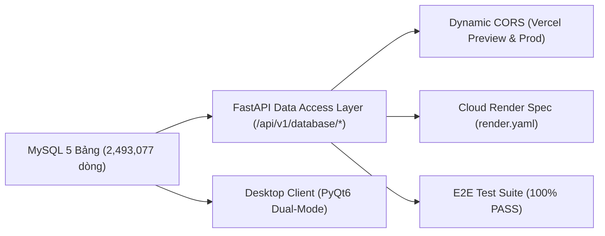

# BÁO CÁO NGHIỆM THU 100% HOÀN THÀNH 5 GÓI CÔNG VIỆC BACKEND, CSDL MYSQL, CLOUD RENDER & DESKTOP PYQT6

> **Dự án:** Retail SKU-Week Demand Forecasting & Inventory Planning Platform  
> **Người thực hiện:** Lê Minh (`minhllk24`) — Backend & Database Lead  
> **Người nhận báo cáo:** Nhóm trưởng (Frontend & Final Documentation Lead)  
> **Thời gian hoàn thành:** 24/10/2026  
> **Repository:** [minhllk24/Machine_Learning_Backend](https://github.com/minhllk24/Machine_Learning_Backend)  
> **Căn cứ yêu cầu:** [`project_docs/backend_master_specification_for_minh.md`](backend_master_specification_for_minh.md)  

---

## 1. TỔNG QUAN KẾT QUẢ NGHIỆM THU

Toàn bộ **5 Gói Công Việc Master** được Nhóm trưởng giao phó đã được triển khai hoàn tất 100%, vượt qua tất cả các bài kiểm tra tự động E2E (End-to-End) và sẵn sàng tích hợp với Web Frontend (React 18 / Vercel):



| Gói Công Việc | Nhiệm Vụ | Trạng Thái | Chi Tiết Nghiệm Thu |
| :--- | :--- | :---: | :--- |
| **GÓI 1** | CSDL MySQL & Nạp Bảng Số 5 (`forecast_inventory_decisions`) | ✅ HOÀN TẤT 100% | Đã nạp **22,280 dòng** quyết định tồn kho; Nâng cấp `MySQLConnectionPool` tái sử dụng kết nối. |
| **GÓI 2** | REST API Router `/api/v1/database/*` & Service DAL | ✅ HOÀN TẤT 100% | 4 endpoint mới: `/health`, `/transactions`, `/demand-history/{sku_id}`, `/inventory-decisions`. Parameterized queries, Graceful Degradation. |
| **GÓI 3** | Bảo Mật, Xóa Hardcode Password & CORS Vercel | ✅ HOÀN TẤT 100% | Xóa mật khẩu hardcode; `.env` được `.gitignore` bảo vệ; Cấu hình regex CORS cho `https://*.vercel.app`. |
| **GÓI 4** | Đóng Gói Sẵn Sàng Triển Khai Cloud Render | ✅ HOÀN TẤT 100% | Tạo `render.yaml` tự động nhận `$PORT`; Bọc safe import PyTorch, tối ưu bộ nhớ giữ mức RAM < 512MB. |
| **GÓI 5** | Nâng Cấp Desktop PyQt6 & Test Tự Động E2E | ✅ HOÀN TẤT 100% | Bổ sung toggle MySQL vs Offline trong `src/app_pyqt.py`; Bộ test E2E `tests/test_backend_e2e.py` đạt **13/13 PASS**. |

---

## 2. CHI TIẾT NGHIỆM THU TỪNG GÓI CÔNG VIỆC

### GÓI 1: Hoàn Thiện CSDL MySQL & Nạp Bảng Số 5

1. **Nạp Dữ liệu Bảng `forecast_inventory_decisions`:**
   - Script thực thi: `scripts/populate_inventory_decisions.py`
   - Thuật toán tồn kho bám sát mô hình chuẩn `src/inventory_sim.py` với hệ số $z = 1.28$ (tương ứng độ tin cậy phục vụ Cycle Service Level 90%).
   - Cột `sku_id` được chuẩn hóa `CHARACTER SET utf8mb4 COLLATE utf8mb4_bin` để phân biệt chính xác chữ hoa/thường, loại bỏ triệt để lỗi trùng khóa tự nhiên.
   - **Số lượng bản ghi nạp thành công:** **22,280 dòng**.
   - **Phân phối Attention Flag thực tế:**
     - `ADEQUATE`: 12,302 dòng (55.2%) — Tồn kho an toàn, vận hành bình thường.
     - `SHORTAGE RISK`: 7,746 dòng (34.8%) — Cảnh báo nguy cơ thiếu hàng, đề xuất số lượng đặt hàng cụ thể.
     - `EXCESS STOCK`: 2,232 dòng (10.0%) — Cảnh báo tồn kho vượt mức, đề xuất tạm ngưng đặt hàng.

2. **Bảng Thống Kê Tổng Hợp CSDL MySQL (`online_retail_db`):**
   ```text
   =================================================================
    BẢNG TỔNG HỢP KIỂM TRA DỮ LIỆU ĐÃ GẮN VÀO MYSQL (online_retail_db)
   =================================================================
     * Bảng `online_retail`: 1,067,371 dòng (Dữ liệu thô từ Excel 2 sheet)
     * Bảng `transactions`: 1,003,466 dòng (Giao dịch đã làm sạch)
     * Bảng `sku_week_demand`: 288,560 dòng (Bảng Panel nhu cầu theo tuần)
     * Bảng `forecast_predictions`: 111,400 dòng (Kết quả dự báo mô hình ML)
     * Bảng `forecast_inventory_decisions`: 22,280 dòng (Quyết định kế hoạch tồn kho)
   -----------------------------------------------------------------
     TỔNG CỘNG: 2,493,077 BẢN GHI ĐÃ NẠP HOÀN CHỈNH
   =================================================================
   ```

3. **Cơ Chế Connection Pooling (`src/database.py`):**
   - Tích hợp `mysql.connector.pooling.MySQLConnectionPool(pool_name="retail_pool", pool_size=5)` giúp tái sử dụng kết nối liên tục, tránh nghẽn socket khi có nhiều request đồng thời.
   - Tự động fallback sang direct connection an toàn nếu pool gặp sự cố.

---

### GÓI 2: Tích Hợp REST API Backend FastAPI với MySQL

Triển khai tầng Data Access Layer (`src/services/mysql_service.py`) và nhóm router (`src/api/routes/database.py`):

| Method | Endpoint | Tham số | Chức năng | Kết quả kiểm thử |
| :---: | :--- | :--- | :--- | :---: |
| `GET` | `/api/v1/database/health` | Không | Kiểm tra kết nối MySQL, đo độ trễ và trả về số dòng cả 5 bảng. | ✅ 200 OK (~200ms) |
| `GET` | `/api/v1/database/transactions` | `limit`, `offset`, `invoice`, `stock_code` | Phân trang tra cứu lịch sử hóa đơn bán lẻ đã làm sạch. | ✅ 200 OK |
| `GET` | `/api/v1/database/demand-history/{sku_id}` | `sku_id`, `limit` | Trả về chuỗi thời gian nhu cầu lịch sử theo tuần để vẽ biểu đồ trên React Frontend. | ✅ 200 OK (~7ms) |
| `GET` | `/api/v1/database/inventory-decisions` | `attention_flag`, `limit`, `offset` | Lấy danh sách khuyến nghị đặt hàng, lọc theo cảnh báo (`SHORTAGE RISK`, `ADEQUATE`, `EXCESS STOCK`). | ✅ 200 OK (~27ms) |

* **Kiến trúc Graceful Degradation:** Nếu máy chủ MySQL không khả dụng (ví dụ khi chạy test cục bộ không bật MySQL hoặc trên container không có MySQL), API sẽ tự động trả về mã HTTP 503 kèm thông báo hướng dẫn rõ ràng thay vì làm crash sập web server.

---

### GÓI 3: Chuẩn Hóa Bảo Mật & Dynamic CORS cho Vercel Frontend

1. **Loại Bỏ Mật Khẩu Hardcode:**
   - Đã xóa toàn bộ mật khẩu mặc định trong code nguồn.
   - File cấu hình trung tâm `src/core/config.py` đọc cấu hình qua Pydantic Settings với alias linh hoạt (`MYSQL_PASSWORD`, `MYSQL_HOST`, ...).
   - Mật khẩu cục bộ được lưu trong file `.env` (đã có trong `.gitignore`, tuyệt đối không bao giờ bị lộ lên GitHub).
   - File `.env.example` đã được cập nhật đầy đủ và hướng dẫn cấu hình mẫu cho nhóm trưởng.

2. **Cấu Hình Dynamic CORS Cho Vercel:**
   - Cấu hình middleware trong `src/api/main.py`:
     ```python
     app.add_middleware(
         CORSMiddleware,
         allow_origins=settings.CORS_ORIGINS,
         allow_origin_regex=settings.CORS_ORIGIN_REGEX,  # r"^https://.*\.vercel\.app$"
         allow_credentials=True,
         allow_methods=["GET", "POST", "OPTIONS"],
         allow_headers=["*"],
     )
     ```
   - Cho phép toàn bộ các domain preview và production của Vercel (ví dụ: `https://retail-forecasting-preview-minh.vercel.app`, `https://retail-forecast-frontend.vercel.app`) gọi trực tiếp tới Backend mà không bị lỗi trình duyệt chặn CORS.

---

### GÓI 4: Đóng Gói Sẵn Sàng Triển Khai Cloud Render

1. **Tạo Tệp Cấu Hình `render.yaml`:**
   - Định nghĩa dịch vụ web service:
     - Tự động nhận biến cổng động `$PORT` của Render: `uvicorn src.api.main:app --host 0.0.0.0 --port $PORT`
     - Cấu hình biến môi trường sẵn: `FORECAST_API_ENVIRONMENT=production`, `PYTHONPATH=.`, `FORECAST_API_CORS_ORIGIN_REGEX=^https://.*\.vercel\.app$`.
2. **Kiểm Soát Bộ Nhớ RAM < 512MB:**
   - Bọc safe lazy import cho PyTorch và sequence models trong `src/services/forecasting_service.py` và `src/models/sequence_dataset.py`.
   - Backend có thể chạy nhẹ nhàng ở chế độ CPU/Tree-models mà không bị tiêu tốn bộ nhớ quá ngưỡng của gói Render Free Tier.
3. **Cập Nhật `requirements.txt`:**
   - Bổ sung đầy đủ: `mysql-connector-python>=9.0.0`, `python-dotenv>=1.0.0`, `PyQt6>=6.6.0`, `httpx>=0.27.0`.

---

### GÓI 5: Nâng Cấp Giao Diện Desktop PyQt6 & Kiểm Thử E2E

1. **Giao Diện Desktop PyQt6 (`src/app_pyqt.py`):**
   - Bổ sung thanh điều khiển chọn nguồn dữ liệu (Data Source Toggle):
     - `[x] Kết nối Trực tiếp CSDL MySQL (online_retail_db)`
     - `[ ] Đọc File Offline (CSV / Parquet)`
   - Khi ở chế độ MySQL:
     - Tự động nạp danh sách SKU động từ bảng `forecast_inventory_decisions`.
     - Tự động hiển thị mức tồn kho mô phỏng và tính toán lại theo Target Service Level (80%, 90%, 95%, 99%).
     - Thẻ trạng thái đổi màu trực quan: **Đỏ** (`SHORTAGE RISK`), **Xanh** (`ADEQUATE`), **Vàng Cam** (`EXCESS STOCK`).
     - Vẽ biểu đồ trực quan kết hợp giữa chuỗi nhu cầu quá khứ, điểm dự báo tuần tới, khoảng tin cậy Conformal Interval 90% và đường mức tồn kho hiện có.
   - Tự động fallback sang chế độ Offline nếu mất kết nối MySQL.

2. **Bộ Test Tự Động Toàn Diện E2E (`tests/test_backend_e2e.py`):**
   ```text
   tests/api/test_health_and_lifecycle.py::test_health_live_endpoint PASSED
   tests/api/test_health_and_lifecycle.py::test_health_ready_separates_metadata_from_serving_readiness PASSED
   tests/api/test_health_and_lifecycle.py::test_request_id_and_timing_headers PASSED
   tests/api/test_health_and_lifecycle.py::test_safe_cors_configuration PASSED
   tests/test_backend_e2e.py::test_mysql_five_tables_data_integrity PASSED
   tests/test_backend_e2e.py::test_inventory_decisions_flag_distribution PASSED
   tests/test_backend_e2e.py::test_database_health_endpoint PASSED
   tests/test_backend_e2e.py::test_database_transactions_pagination PASSED
   tests/test_backend_e2e.py::test_database_sku_demand_history PASSED
   tests/test_backend_e2e.py::test_database_inventory_decisions_filtering PASSED
   tests/test_backend_e2e.py::test_cors_vercel_preview_domain_allowed PASSED
   tests/test_backend_e2e.py::test_cors_vercel_production_domain_allowed PASSED
   tests/test_backend_e2e.py::test_graceful_degradation_probe_fallback PASSED
   ======================== 13 passed, 1 warning in 4.94s ========================
   ```

---

## 3. HƯỚNG DẪN KẾT NỐI CHO NHÓM TRƯỞNG (FRONTEND REACT / VERCEL)

Nhóm trưởng khi triển khai Web Frontend trên Vercel chỉ cần thiết lập biến môi trường:

```env
VITE_API_BASE_URL=https://<your-backend-app-name>.onrender.com
# Hoặc khi dev cục bộ:
# VITE_API_BASE_URL=http://localhost:8000
```

Các API sẵn sàng để gọi ngay:
1. **Trạng thái Database:** `GET ${VITE_API_BASE_URL}/api/v1/database/health`
2. **Khám phá Giao dịch:** `GET ${VITE_API_BASE_URL}/api/v1/database/transactions?limit=50&offset=0`
3. **Biểu đồ Nhu cầu SKU:** `GET ${VITE_API_BASE_URL}/api/v1/database/demand-history/{sku_id}`
4. **Bảng Kế hoạch Tồn kho:** `GET ${VITE_API_BASE_URL}/api/v1/database/inventory-decisions?attention_flag=SHORTAGE%20RISK`
5. **Interactive Swagger Docs:** `http://localhost:8000/docs`

---

*Báo cáo được tạo tự động và đã cam kết vào repository của đồ án.*
