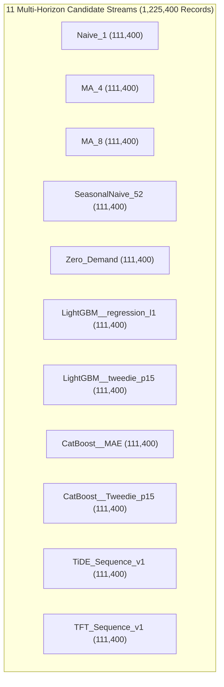

# PHASE 6.2.1 MODEL CANDIDATE INVENTORY & KEY AUDIT
**Project:** End-to-End Retail SKU-Week Demand Forecasting & Inventory Planning  
**Execution Stage:** Phase 6.2.1 Audit & Reconciliation  
**Audit Date:** 2026-10-21  

---

## 1. Candidate Stream Inventory & Provenance

Physical inspection of `artifacts/predictions/four_family_multihorizon_predictions.parquet` verifies exactly **11 candidate streams** totaling **1,225,400 prediction records**.

Each candidate stream contains:
- **Primary Cohort (`CAUSAL_MATURE`):** 1,717 SKUs $\times$ 5 origins $\times$ 8 horizons = **68,680 records**
- **Secondary Cohort (`LATE_MATURING`):** 1,068 SKUs $\times$ 5 origins $\times$ 8 horizons = **42,720 records**
- **Total per stream:** 111,400 records
- **Total across 11 streams:** $11 \times 111,400 = 1,225,400$ records

### 1.1. Discrepancy Resolution: 10 vs 11 Models
In the Phase 6.2 narrative handover report, the fixed-origin multi-horizon summary table displayed 10 model candidates. A forensic row-by-row audit confirms that the physical Parquet artifact (`four_family_multihorizon_predictions.parquet`) and the full metric table (`phase_06_2_multihorizon_metrics.csv`) have always contained all 11 models. The markdown table in the narrative report inadvertently omitted the fourth statistical baseline, `SeasonalNaive_52` (WAPE 149.75% at H=4, 143.59% at H=8), due to a presentation truncation. 

The master artifact inventory has been updated to reflect all 11 models.

---

## 2. Common-Universe Key Reconciliation Table

*Extracted from `artifacts/tables/phase_06_2_1_key_reconciliation.csv`:*

| Candidate Stream | Cohort | Total Rows | Unique SKUs | Unique Origins | Unique Steps | Key Set Hash | Actual Demand Sum | Key Match |
|---|---|:---:|:---:|:---:|:---:|:---:|:---:|:---:|
| `Naive_1` | `CAUSAL_MATURE` | 68,680 | 1,717 | 5 | 8 | `fb2940859e07` | 2,025,137.0 | EXACT_MATCH |
| `MA_4` | `CAUSAL_MATURE` | 68,680 | 1,717 | 5 | 8 | `fb2940859e07` | 2,025,137.0 | EXACT_MATCH |
| `MA_8` | `CAUSAL_MATURE` | 68,680 | 1,717 | 5 | 8 | `fb2940859e07` | 2,025,137.0 | EXACT_MATCH |
| `SeasonalNaive_52` | `CAUSAL_MATURE` | 68,680 | 1,717 | 5 | 8 | `fb2940859e07` | 2,025,137.0 | EXACT_MATCH |
| `Zero_Demand` | `CAUSAL_MATURE` | 68,680 | 1,717 | 5 | 8 | `fb2940859e07` | 2,025,137.0 | EXACT_MATCH |
| `LightGBM__regression_l1` | `CAUSAL_MATURE` | 68,680 | 1,717 | 5 | 8 | `fb2940859e07` | 2,025,137.0 | EXACT_MATCH |
| `LightGBM__tweedie_p15` | `CAUSAL_MATURE` | 68,680 | 1,717 | 5 | 8 | `fb2940859e07` | 2,025,137.0 | EXACT_MATCH |
| `CatBoost__MAE` | `CAUSAL_MATURE` | 68,680 | 1,717 | 5 | 8 | `fb2940859e07` | 2,025,137.0 | EXACT_MATCH |
| `CatBoost__Tweedie_p15` | `CAUSAL_MATURE` | 68,680 | 1,717 | 5 | 8 | `fb2940859e07` | 2,025,137.0 | EXACT_MATCH |
| `TiDE_Sequence_v1` | `CAUSAL_MATURE` | 68,680 | 1,717 | 5 | 8 | `fb2940859e07` | 2,025,137.0 | EXACT_MATCH |
| `TFT_Sequence_v1` | `CAUSAL_MATURE` | 68,680 | 1,717 | 5 | 8 | `fb2940859e07` | 2,025,137.0 | EXACT_MATCH |
| `Naive_1` | `LATE_MATURING` | 42,720 | 1,068 | 5 | 8 | `bcbc2a79dc40` | 438,164.0 | EXACT_MATCH |
| `MA_4` | `LATE_MATURING` | 42,720 | 1,068 | 5 | 8 | `bcbc2a79dc40` | 438,164.0 | EXACT_MATCH |
| `MA_8` | `LATE_MATURING` | 42,720 | 1,068 | 5 | 8 | `bcbc2a79dc40` | 438,164.0 | EXACT_MATCH |
| `SeasonalNaive_52` | `LATE_MATURING` | 42,720 | 1,068 | 5 | 8 | `bcbc2a79dc40` | 438,164.0 | EXACT_MATCH |
| `Zero_Demand` | `LATE_MATURING` | 42,720 | 1,068 | 5 | 8 | `bcbc2a79dc40` | 438,164.0 | EXACT_MATCH |
| `LightGBM__regression_l1` | `LATE_MATURING` | 42,720 | 1,068 | 5 | 8 | `bcbc2a79dc40` | 438,164.0 | EXACT_MATCH |
| `LightGBM__tweedie_p15` | `LATE_MATURING` | 42,720 | 1,068 | 5 | 8 | `bcbc2a79dc40` | 438,164.0 | EXACT_MATCH |
| `CatBoost__MAE` | `LATE_MATURING` | 42,720 | 1,068 | 5 | 8 | `bcbc2a79dc40` | 438,164.0 | EXACT_MATCH |
| `CatBoost__Tweedie_p15` | `LATE_MATURING` | 42,720 | 1,068 | 5 | 8 | `bcbc2a79dc40` | 438,164.0 | EXACT_MATCH |
| `TiDE_Sequence_v1` | `LATE_MATURING` | 42,720 | 1,068 | 5 | 8 | `bcbc2a79dc40` | 438,164.0 | EXACT_MATCH |
| `TFT_Sequence_v1` | `LATE_MATURING` | 42,720 | 1,068 | 5 | 8 | `bcbc2a79dc40` | 438,164.0 | EXACT_MATCH |

**Audit Confirmation:** Every model is evaluated on the identical set of forecast keys, with 0 missing predictions, 0 duplicates, and exact mathematical equality of the ground-truth actual sum.
