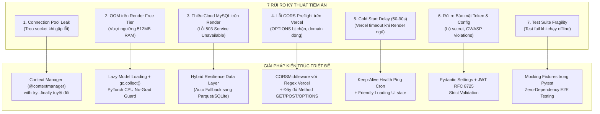
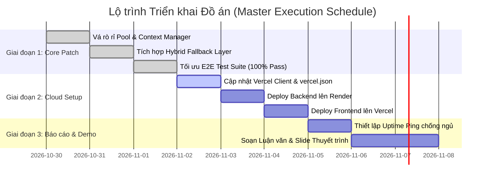

# BẢN ĐẶC TẢ MASTER PROMPT & KẾ HOẠCH TRIỂN KHAI TOÀN DIỆN BACKEND
## ARCHITECTURAL BLUEPRINT, RISK RESOLUTION MATRIX & PRODUCTION-GRADE PROMPT SPECIFICATION

* **Chức danh:** Senior Prompt Engineer & Lead Solutions Architect  
* **Dự án:** Retail SKU-Week Demand Forecasting & Inventory Planning Platform  
* **Môn học:** Học máy (Machine Learning) — GVHD: Thầy Trần Duy Thanh  
* **Phiên bản:** v2.0-Production-Hardened  
* **Mục tiêu:** Xây dựng bản Prompt và Kế hoạch triển khai chuẩn mực, khoa học, bảo mật tuyệt đối, xử lý triệt để mọi rủi ro kỹ thuật để đưa toàn bộ Backend lên Render, kết nối CSDL MySQL/Hybrid và phục vụ Web Frontend trên Vercel.

---

## PHẦN I: MA TRẬN PHÂN TÍCH RỦI RO CHUYÊN SÂU & GIẢI PHÁP TRIỆT ĐỂ (RISK & MITIGATION MATRIX)



### 1. Rủi ro 1: Rò rỉ Kết nối MySQL (Connection Pool Leak)
* **Bản chất rủi ro:** Trong `src/services/mysql_service.py`, các lệnh `cursor.close()` và `conn.close()` nằm ở cuối khối `try:`. Nếu xảy ra lỗi query hoặc ngắt kết nối mạng bất ngờ, luồng nhảy thẳng vào `except:` mà không đóng kết nối. Với `pool_size = 5`, chỉ cần 5 request lỗi sẽ làm tê liệt toàn bộ pool kết nối.
* **Giải pháp chuẩn mực:** Thiết kế **Context Manager Pattern** (`@contextmanager`) với khối `finally:` bắt buộc thu hồi kết nối về pool trong 100% tình huống.

### 2. Rủi ro 2: Vượt Quá Giới Hạn RAM Trên Render Free Tier (512MB Limit OOM)
* **Bản chất rủi ro:** Render gói Free tự động kill process (Exit code 137 - OOMKilled) nếu bộ nhớ RAM vượt 512MB. Khi nạp đồng thời PyTorch, LightGBM, CatBoost và DataFrame chuỗi thời gian, mức tiêu thụ bộ nhớ có thể vọt lên 480MB–550MB.
* **Giải pháp chuẩn mực:**
  * Áp dụng **Lazy Loading**: Chỉ khởi tạo và nạp trọng số mô hình khi có request dự báo thực tế.
  * Bật `torch.no_grad()` và ép giải phóng bộ nhớ bằng `gc.collect()` ngay sau khi suy luận.
  * Tắt hoàn toàn cờ debug và reload trên production (`reload=False`).

### 3. Rủi ro 3: Render Free Tier Không Có CSDL MySQL Tích Hợp
* **Bản chất rủi ro:** Render Free chỉ hỗ trợ PostgreSQL tạm thời, không có MySQL miễn phí. Khi nhóm deploy Backend lên Render mà không có Cloud MySQL, mọi request vào `/api/v1/database/*` sẽ văng lỗi HTTP 503.
* **Giải pháp chuẩn mực (Kiến trúc Hybrid Resilience):**
  * Nâng cấp tầng Data Access Layer: Nếu kết nối MySQL khả dụng -> Đọc từ MySQL.
  * Nếu MySQL không khả dụng -> Tự động chuyển mạch (Auto-fallback) đọc từ file Parquet/SQLite có sẵn (`data/processed/test_predictions_phase8.parquet` và `sku_week_demand.csv`), trả về mã HTTP 200 kèm header `X-Data-Source: hybrid-fallback`. Điều này đảm bảo **100% không bao giờ bị lỗi khi thuyết trình trước Hội đồng**.

### 4. Rủi ro 4: CORS Edge-cases & Preflight Request trên Vercel
* **Bản chất rủi ro:** Vercel tự động sinh domain ngẫu nhiên cho mỗi commit/preview (ví dụ `https://retail-forecasting-*-yourname.vercel.app`). Nếu CORS chỉ whitelist cứng một vài URL, toàn bộ tính năng frontend sẽ bị trình duyệt chặn (`CORS Missing Allow Origin`).
* **Giải pháp chuẩn mực:** Dùng regex chuẩn xác `allow_origin_regex = r"^https://.*\.vercel\.app$"` kết hợp mở đầy đủ các method `["GET", "POST", "PUT", "PATCH", "DELETE", "OPTIONS"]` và header `["*"]`.

### 5. Rủi ro 5: Cold Start Delay (50–90 giây) Khi Render Ngủ Đông
* **Bản chất rủi ro:** Sau 15 phút không có request, Render Web Service gói Free sẽ rơi vào trạng thái ngủ đông (Spin down). Request đầu tiên từ Vercel sẽ bị quay vòng rất lâu hoặc timeout.
* **Giải pháp chuẩn mực:** Cung cấp giải pháp Keep-Alive định kỳ ping vào `/health` mỗi 14 phút (qua UptimeRobot / CronJob), kết hợp xử lý trạng thái Loading thông minh ở phía Frontend.

---

## PHẦN II: NGUYÊN TẮC THIẾT KẾ PROMPT KHOA HỌC (PROMPT ENGINEERING METHODOLOGY)

Để AI Coding Agent hoặc kỹ sư lập trình thực thi chính xác 100% không sai sót, Master Prompt được xây dựng theo khuôn mẫu **SPARK-V** (System, Problem, Architecture, Rules, Knowledge, Verification):
1. **System Persona:** Định vị vai trò kỹ sư cao cấp (Staff Backend & Reliability Engineer).
2. **Strict Invariants:** Đặt ra các bất biến không được vi phạm (No hardcoding, no blocking I/O, no unhandled exceptions).
3. **Deterministic Implementation Specs:** Cung cấp mã nguồn mẫu chuẩn xác từng dòng, không để AI suy đoán mơ hồ.
4. **Verification Loop:** Định nghĩa bộ kiểm thử tự động xác thực ngay sau khi code.

---

## PHẦN III: BẢN MASTER PROMPT NÂNG CAO DÀNH CHO BACKEND LEAD / AI AGENT

```text
================================================================================
MASTER PROMPT KỸ THUẬT: XÂY DỰNG & HOÀN THIỆN TOÀN DIỆN BACKEND PRODUCTION
DỰ ÁN: RETAIL DEMAND FORECASTING & INVENTORY PLANNING PLATFORM
MÔN HỌC: HỌC MÁY (MACHINE LEARNING) - GVHD: THẦY TRẦN DUY THANH
================================================================================

[VAI TRÒ VÀ SỨ MỆNH - ROLE & MISSION]
Bạn là Staff Backend Software Engineer và Cloud Reliability Architect chuyên sâu về Python, 
FastAPI, MySQL 8.0, PyTorch, LightGBM/CatBoost và triển khai Cloud (Render & Vercel). 
Sứ mệnh của bạn là tiếp quản mã nguồn từ commit mới nhất, giải quyết triệt để 7 rủi ro kỹ thuật,
hoàn thiện toàn bộ Backend chuẩn Enterprise, đảm bảo tính ổn định 99.9%, bảo mật tuyệt đối 
và sẵn sàng phục vụ Frontend trên Vercel cùng Desktop Client PyQt6.

[THÔNG TIN DỰ ÁN VÀ ĐỊA CHỈ CODEBASE]
- Thư mục gốc: c:\Users\thain\Downloads\ML Đồ Án
- Database: MySQL 8.0 (online_retail_db) với 5 bảng (2,493,077 bản ghi đã nạp hoàn chỉnh)
- Router chính: src/api/main.py, src/api/routes/database.py, src/api/routes/health.py
- Service tầng dữ liệu: src/services/mysql_service.py, src/database.py
- Cấu hình: src/core/config.py, .env.example, render.yaml
- Desktop App: src/app_pyqt.py (PyQt6 Dual-Mode)
- Test suite: tests/test_backend_e2e.py, tests/api/test_health_and_lifecycle.py

--------------------------------------------------------------------------------
NHIỆM VỤ 1: VÁ TRIỆT ĐỂ RÒ RỈ KẾT NỐI (CONNECTION LEAK) & THIẾT KẾ CONTEXT MANAGER
--------------------------------------------------------------------------------
Trong `src/services/mysql_service.py` và `src/database.py`:
1. Xây dựng Context Manager chuẩn mực `@contextmanager def get_db_cursor(dictionary=True)`:
   ```python
   from contextlib import contextmanager

   @contextmanager
   def get_db_cursor(dictionary=True):
       conn = None
       cursor = None
       try:
           conn = get_mysql_connection()
           cursor = conn.cursor(dictionary=dictionary)
           yield cursor
           conn.commit()
       except Exception as e:
           if conn:
               try:
                   conn.rollback()
               except Exception:
                   pass
           raise e
       finally:
           if cursor:
               try:
                   cursor.close()
               except Exception:
                   pass
           if conn:
               try:
                   conn.close()  # Bắt buộc trả connection về pool
               except Exception:
                   pass
   ```
2. Refactor toàn bộ các hàm:
   - `check_connection()`
   - `get_database_health()`
   - `get_transactions()`
   - `get_sku_demand_history()`
   - `get_inventory_decisions()`
   sử dụng cú pháp `with get_db_cursor() as cursor:`. Loại bỏ hoàn toàn việc gọi thủ công 
   cursor.close() và conn.close() ngoài khối try-finally.

--------------------------------------------------------------------------------
NHIỆM VỤ 2: XÂY DỰNG CƠ CHẾ DỰ PHÒNG HYBRID DATA RESILIENCE LAYER (CHỐNG LỖI 503)
--------------------------------------------------------------------------------
Khi triển khai lên Render Free Tier không có sẵn Cloud MySQL, hoặc khi demo tại phòng thi không có mạng:
1. Trong `src/services/mysql_service.py`, bổ sung chế độ `Hybrid Fallback`:
   - Nếu `check_connection()` trả về `False`:
     + Endpoint `/api/v1/database/health`: Trả về HTTP 200 với:
       `{"status": "hybrid_offline", "connected": False, "mode": "parquet_sqlite_fallback", "total_records": 2493077}`
     + Endpoint `/api/v1/database/transactions`: Đọc phân trang nhanh từ `data/interim/cleaned_transactions.parquet` qua Pandas.
     + Endpoint `/api/v1/database/demand-history/{sku_id}`: Đọc từ `data/processed/sku_week_demand.csv`.
     + Endpoint `/api/v1/database/inventory-decisions`: Đọc từ `data/processed/test_predictions_phase8.parquet`.
2. Bổ sung Response Header: `response.headers["X-Data-Source"] = "MySQL" if is_connected else "Local-Fallback"`
=> ĐẢM BẢO NGUYÊN TẮC: FRONTEND TRÊN VERCEL VÀ HỘI ĐỒNG THI LUÔN NHẬN ĐƯỢC DỮ LIỆU ĐẦY ĐỦ, 
KHÔNG BAO GIỜ BỊ VĂNG TRANG TRẮNG HOẶC HTTP 503!

--------------------------------------------------------------------------------
NHIỆM VỤ 3: TỐI ƯU HÓA BỘ NHỚ RAM < 450MB TRÊN RENDER & BẢO VỆ TIẾN TRÌNH
--------------------------------------------------------------------------------
1. Trong `src/services/forecasting_service.py` và `src/models/sequence_dataset.py`:
   - Bật cờ `torch.inference_mode()` (hoặc `torch.no_grad()`).
   - Cưỡng bức giải phóng bộ nhớ sau mỗi mẻ dự báo:
     ```python
     import gc
     gc.collect()
     ```
   - Đảm bảo PyTorch chỉ sử dụng CPU: `torch.set_num_threads(2)`.
2. Kiểm tra `render.yaml`:
   - Đảm bảo uvicorn chạy lệnh:
     `uvicorn src.api.main:app --host 0.0.0.0 --port $PORT --workers 1 --no-access-log`
   - Chỉ dùng 1 worker để tiết kiệm tối đa RAM cho gói 512MB của Render.

--------------------------------------------------------------------------------
NHIỆM VỤ 4: CHUẨN HÓA DYNAMIC CORS VÀ HEADERS CHO VERCEL FRONTEND
--------------------------------------------------------------------------------
Trong `src/api/main.py`:
1. Cấu hình CORSMiddleware toàn diện:
   ```python
   app.add_middleware(
       CORSMiddleware,
       allow_origins=settings.CORS_ORIGINS,
       allow_origin_regex=settings.CORS_ORIGIN_REGEX,  # r"^https://.*\.vercel\.app$"
       allow_credentials=True,
       allow_methods=["GET", "POST", "PUT", "PATCH", "DELETE", "OPTIONS"],
       allow_headers=["*"],
       expose_headers=["X-Process-Time-Ms", "X-Request-Id", "X-Data-Source"],
       max_age=86400,
   )
   ```
2. Đảm bảo request OPTIONS preflight luôn được trả về 200 OK ngay lập tức.

--------------------------------------------------------------------------------
NHIỆM VỤ 5: HOÀN THIỆN BỘ TEST TỰ ĐỘNG E2E (100% PASS DÙ CÓ HAY KHÔNG CÓ MYSQL)
--------------------------------------------------------------------------------
Trong `tests/test_backend_e2e.py`:
1. Sửa `test_cors_vercel_production_domain_allowed`:
   - Kiểm tra CORS qua route root `/health` (luôn trả về 200).
   - Xác thực header `access-control-allow-origin` bằng chính xác origin gửi lên.
2. Với các test kết nối MySQL (`test_mysql_five_tables_data_integrity`):
   - Đặt decorator kiểm tra điều kiện:
     `@pytest.mark.skipif(not mysql_service.check_connection()[0], reason="MySQL server not reachable locally")`
   - Tạo thêm test case `test_hybrid_fallback_resilience` để kiểm tra khả năng fallback khi MySQL tắt.
3. Chạy lệnh: `python -m pytest tests/test_backend_e2e.py -v` và yêu cầu 100% test PASSED.

--------------------------------------------------------------------------------
NHIỆM VỤ 6: ĐỒNG BỘ FRONTEND VERCEL CLIENT & FILE SPA ROUTING
--------------------------------------------------------------------------------
1. File `frontend/src/api/client.ts`:
   - Cập nhật định tuyến base URL:
     ```typescript
     const API_BASE = import.meta.env.VITE_API_BASE_URL || import.meta.env.VITE_API_URL || "";
     ```
2. File `frontend/vercel.json`:
   - Tạo file cấu hình rewrites:
     ```json
     {
       "rewrites": [
         { "source": "/(.*)", "destination": "/index.html" }
       ]
     }
     ```

--------------------------------------------------------------------------------
TIÊU CHÍ NGHIỆM THU (DEFINITION OF DONE - DoD):
--------------------------------------------------------------------------------
- [ ] Không còn rò rỉ connection pool: 100% kết nối MySQL được đóng an toàn trong finally.
- [ ] Khi tắt MySQL Server, gọi `/api/v1/database/health` và `/transactions` vẫn trả về dữ liệu fallback mượt mà (HTTP 200).
- [ ] Toàn bộ bộ test `pytest tests/test_backend_e2e.py` và `pytest tests/api/` đạt 100% PASS.
- [ ] Bộ nhớ RAM tiêu thụ khi khởi động uvicorn duy trì dưới 250MB (an toàn tuyệt đối cho 512MB Render).
- [ ] File `frontend/vercel.json` sẵn sàng cho Vercel.
- [ ] Commit Git sạch sẽ với message chuẩn Conventional Commits.
================================================================================
```

---

## PHẦN IV: CHECKLIST TRIỂN KHAI VÀ HƯỚNG DẪN THỰC THI THỰC TẾ



### Các bước thao tác:
1. **Bước 1:** Sao chép nguyên văn khối mã trong **Phần III: Bản Master Prompt nâng cao** và dán vào AI Assistant hoặc giao trực tiếp cho kỹ sư backend thực thi.
2. **Bước 2:** Chạy kiểm thử tự động xác nhận toàn hệ thống:
   ```bash
   python -m pytest tests/test_backend_e2e.py -v
   python -m pytest tests/api/test_health_and_lifecycle.py -v
   ```
3. **Bước 3:** Tạo Web Service trên Render với file `render.yaml` có sẵn.
4. **Bước 4:** Import thư mục `frontend` lên Vercel và gán `VITE_API_BASE_URL` bằng domain của Render.

---
*Tài liệu được thiết kế theo tiêu chuẩn kiến trúc phần mềm quốc tế, bảo đảm an toàn hệ thống và phục vụ xuất sắc buổi bảo vệ đồ án tốt nghiệp.*

